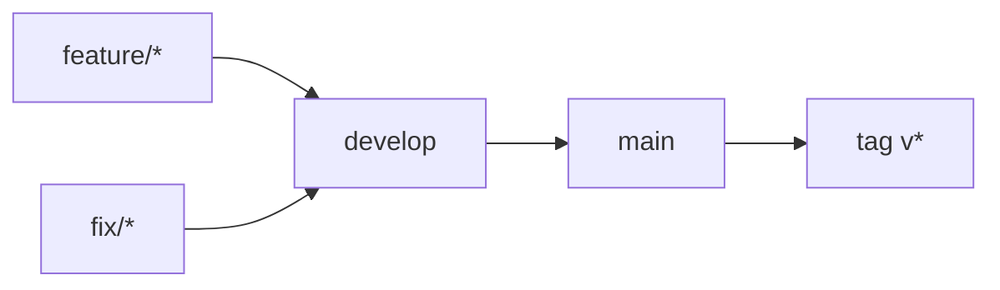

# Gitflow

Flux de branches du dépôt, équivalent à [occt-wasm](https://github.com/naanouff/occt-wasm/blob/main/docs/gitflow.md) :

```text
feature/* | fix/*  →  develop  →  main  →  release (tag v*)
```



Sprint de finalisation : [sprint-36-gitflow.md](sprints/sprint-36-gitflow.md). Plan détaillé : [veille/gitflow-protection.md](veille/gitflow-protection.md).

## Branches long-lived

| Branche | Rôle |
|---------|------|
| `develop` | Intégration. Cible par défaut des PR `feature/*` et `fix/*`. |
| `main` | Production. Reçoit uniquement des PR depuis `develop` (promotion). |

Branche par défaut GitHub : `main`.

## Branches de travail

| Préfixe | Usage | Merge dans |
|---------|--------|------------|
| `feature/` | Nouvelle capacité | `develop` |
| `fix/` | Correctif hors prod urgente | `develop` |

Pas de commits directs sur `develop` ni `main` (PR obligatoires via rulesets). Les admins du dépôt peuvent bypasser (rôle Repository admin) pour les urgences.

Definitions versionnées : [`.github/rulesets/`](../.github/rulesets/).

## Protections GitHub (rulesets)

Rulesets actifs sur le dépôt `naanouff/OpenCadEditor` :

| Ruleset | Cible | Règles |
|---------|-------|--------|
| `gitflow-protect-main` | `refs/heads/main` | PR obligatoire, pas de suppression, pas de force-push |
| `gitflow-protect-develop` | `refs/heads/develop` | idem |

Bypass : rôle Repository admin. Sources versionnées dans [`.github/rulesets/`](../.github/rulesets/).

## Suppression après merge

Après merge d’une PR, la branche source (`feature/*`, `fix/*`, …) est **supprimée automatiquement** (`Settings → General → Automatically delete head branches`, API `delete_branch_on_merge`).

`main` et `develop` restent non supprimables grâce aux rulesets. Les trois méthodes de merge (`merge` / `squash` / `rebase`) déclenchent toutes cette suppression.

## Politique de PR (CI)

Le workflow [`.github/workflows/branch-policy.yml`](../.github/workflows/branch-policy.yml) refuse les PR hors-flux :

| Base | Head autorisée |
|------|----------------|
| `develop` | `feature/*`, `fix/*`, `chore/*` |
| `main` | `develop` uniquement |

Pas de PR `feature/*` / `fix/*` → `main`. La CI échoue sur ces PR.

Le workflow [`.github/workflows/ci.yml`](../.github/workflows/ci.yml) lance Vitest sur les quatre paquets (job `tests`). Les rulesets versionnés exigent ce statut ; synchroniser l’API GitHub après une run verte sur `develop` (sprint 37).

## Promotion et release

1. Intégrer les PR `feature/*` / `fix/*` dans `develop` (branche source effacée au merge).
2. Quand `develop` est prêt : PR `develop` → `main`.
3. Sur `main`, créer le tag semver : `git tag v0.1.0 && git push origin v0.1.0`.

Les tags `v*` ne sont valides que s’ils pointent un commit déjà sur `main`.

## Hors modèle (volontairement)

- Pas de branches `release/*` ni `hotfix/*` pour l’instant.
- Correctif urgent : `fix/*` → `develop` → PR rapide vers `main` → tag.
- La branche historique `feature/initial` a porté le prototype ; le flux courant part de `develop`.

## Commandes usuelles

```bash
git fetch origin
git checkout develop
git pull origin develop

git checkout -b feature/ma-feature
# … commits …
git push -u origin HEAD
# ouvrir une PR vers develop

# promotion
# PR develop → main, puis :
git checkout main
git pull origin main
git tag v0.1.0
git push origin v0.1.0
```
