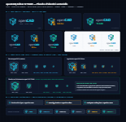

# Identité graphique openCAD / openCAD Editor

| Document | Rôle |
|----------|------|
| [planche-identite.svg](planche-identite.svg) | **Source vectorielle** (symboles officiels) |
| [planche-identite-opencad-editor.png](planche-identite-opencad-editor.png) | Aperçu raster de la planche |
| [charte.md](charte.md) | Palette, logo, thèmes |
| [kit/](kit/) | Symboles **extraits** de la planche : SVG + PNG + WebP |

Tokens UI maquette : [`../maquette/v2/src/ds/tokens.css`](../maquette/v2/src/ds/tokens.css).

