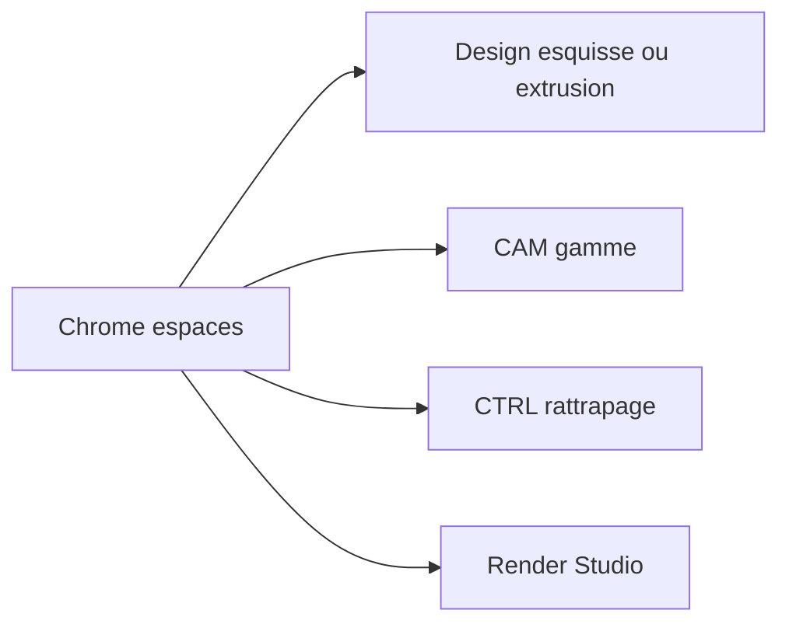

# Plan — espaces CAM, CTRL, Render Studio

Maquette seulement : [v2](v2/). Design (esquisse / extrusion) reste l’espace par défaut. CAM, CTRL et Render Studio sont des **espaces** : ils changent le ruban, le browser, le viewport, l’inspector et la timeline. Les identifiants Dockview ne changent pas.

Aucune ligne `Session`, aucun OCCT, aucun toolpath calculé, aucun raytracing.

Sprint : [sprint 65](../sprints/sprint-65-maquette-espaces.md).

## Bascule

Dans le chrome, un sélecteur d’espace :

`Design · CAM · CTRL · Render`

Les états A (esquisse) et B (extrusion) ne s’affichent que dans Design.

État React : `workspace: 'design' | 'cam' | 'ctrl' | 'render'`.

## CAM — gamme de fabrication

Pièces du fichier de définition de la boîte : Carrure, Lunette, Verre, Fond, Couronne. Chaque pièce a un setup par couple machine + posage. Carrure et Couronne en ont deux.

| Zone | Contenu |
|------|---------|
| Ruban | Setup, Ébauche, Finition, Perçage, Simuler. Post grisé : « pas de machine » |
| Browser | Pièce → Setup (outils, brut, final, posage) → opération → parcours et tool |
| Viewport | Anneau + parcours. Repères machine et brut, bouton Superposer. Simuler : stock qui s’amincit, `applyUntil(t)` |
| Inspector | Profil d’outil, silhouette du posage avec la pièce en évidence, puis machine, brut, final |
| Timeline | Opérations du setup, tête de lecture sur l’opération (et sur `simT` pendant Simuler) |

## CTRL — mesure et rattrapage

Les cotes viennent du MBD de `carrure.cadompart`. Le rattrapage est nul si le relevé reste dans la bande.

| Zone | Contenu |
|------|---------|
| Ruban | Mesurer, Écart, Appliquer le rattrapage, Verrouiller |
| Browser | `diametre_boite` 40 ±0,05 · 40,08 hors ; `epaisseur_paroi` ±0,05 dans ; `entrecorne` ±0,10 dans |
| Viewport | Nominal, mini et maxi MBD, relevé |
| Inspector | Tolérance, mini, maxi, écart, état, rattrapage. Appliquer met à jour le libellé, n’écrit aucune ligne |
| Timeline | Relevé 1, puis Rattrapage |

## Render Studio

| Zone | Contenu |
|------|---------|
| Ruban | Caméra, Lumière, Matière, Environnement, Générer |
| Browser | Caméra 3/4, lumières clé et fill, matière acier brossé sur Carrure |
| Viewport | Anneau sur fond studio, sans grille CAO. Après Générer : pastille « Rendu 1 · 2 s » |
| Inspector | Matière, rugosité, HDRI, résolution 1920×1080 |
| Timeline | « Rendu 1 » ajouté au clic sur Générer |

Le rendu est une image statique simulée.

## Fichiers

| Fichier | Rôle |
|---------|------|
| `v2/src/mockState.tsx` | `workspace`, opération, variable, rendu généré |
| `v2/src/Chrome.tsx` | Sélecteur d’espace |
| `v2/src/Ribbon.tsx` | Ruban de chaque espace |
| `v2/src/panels/*` | Contenu selon `workspace` |
| `v2/plan-layout.md`, `v2/README.md` | Zones et hors scope |

Charte inchangée. Cyan pour CAM, CTRL et Render. Icônes Lucide seulement.

## Hors de ce plan

Machine réelle, post-processeur, métrologie, solveur de rattrapage, path tracing, WebGPU, formats `.cadomfab` et `.cadomctrl`.
