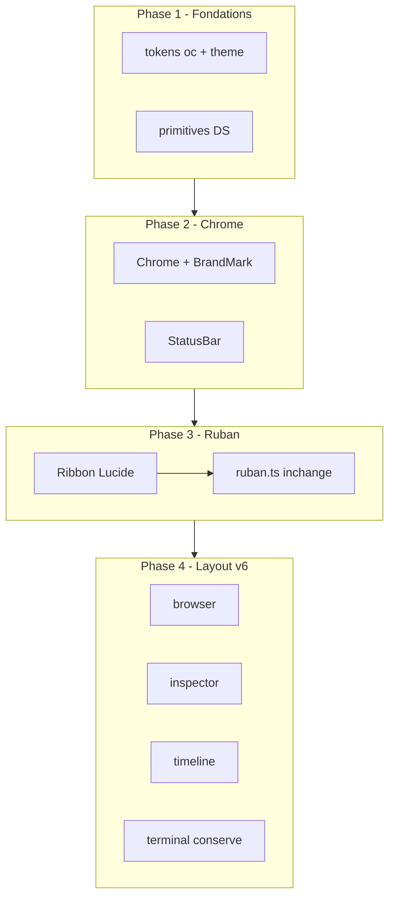

# Plan — intégration maquette v2 → shell

Porter la [maquette v2](v2/) dans [`packages/shell`](../../packages/shell) par couches. La maquette reste la référence visuelle (spec vivante) ; le shell reste le seul runtime Session / OCCT / WebGPU.

Références : [plan-v2.md](plan-v2.md), [v2/plan-layout.md](v2/plan-layout.md), [charte.md](../graphique/charte.md), [editor-ui.md](../shell/editor-ui.md), [pilotage-lignes.md](../veille/pilotage-lignes.md). Premier sprint : [sprint-67-shell-ds.md](../sprints/sprint-67-shell-ds.md).

## Décisions retenues

- **Cible UI** : composition Whittle — `browser` · `viewport` · `inspector` · `timeline` — **plus** le `terminal` (doctrine P4 : lignes `Session`).
- **Espaces** : **Design seulement** dans le shell. CAM / CTRL / Render restent dans la maquette ([sprint 65](../sprints/sprint-65-maquette-espaces.md), [plan-espaces.md](plan-espaces.md)) jusqu’à des verbes Session réels.
- **Design system** : port immédiat vers `packages/shell/src/ds/` (pas de `packages/ui` tant que le jet n’est pas stable). Extraction ultérieure hors périmètre.
- **Pilotage** : le ruban continue d’émettre via `ruban.ts` → `storeShell.executer` ; on ne reprend **pas** `mockState.tsx`.
- **Viewport** : WebGPU réel inchangé ; on greffe uniquement les affordances UI (filtres, barre flottante) autour du canvas.

## Écart actuel

| Couche | Shell aujourd’hui | Maquette v2 |
|--------|-------------------|-------------|
| Cadre | `RubanVue` seul | `Chrome` + `Ribbon` + `StatusBar` |
| Dock | 7 panels (`layout.v5`) | 4 panels Whittle |
| Thème | `w3dts.viewer.theme` (w3dts/dark/light/system) | `opencad.maquette.v2.theme` (light/dark + `--oc-*`) |
| Ruban | texte minimal, réel | icônes, disabled+raison, mock |
| DS | editor-ui `Panel` / `--color-*` | `ds/` primitives + bridge `--oc-*` → `--color-*` |

Sources : `packages/shell/src/App.tsx`, `documentation/maquette/v2/src/App.tsx`.

## Phase 1 — Design system dans le shell

Sprint : [67](../sprints/sprint-67-shell-ds.md). Branche : `feature/shell-ds`. **Fait.**

**Livrable** : tokens + primitives consommables par le shell, sans changer le layout Dockview.

1. Copier `documentation/maquette/v2/src/ds/` → `packages/shell/src/ds/`.
2. Étendre Tailwind shell avec les classes `oc-*`.
3. Unifier le thème : préférence OpenCad `light|dark` (`opencad.shell.theme`), bridge `--oc-*` → `--color-*` pour Dockview / viewport.
4. Remplacer progressivement les couleurs en dur par les tokens (sans refactor structurel).

**Done** : bascule light/dark persistée (toggle ruban) ; layout `v5` inchangé ; pas de régression viewport.

## Phase 2 — Chrome + StatusBar (Design)

Branche prévue : `feature/shell-chrome`.

1. Porter `Chrome.tsx` + `BrandMark.tsx` ; brancher titre / document / undo (ou disabled + raison).
2. Pas de sélecteur CAM / CTRL / Render.
3. `StatusBar` sous le dock (sélection topo, mode esquisse, unité).

## Phase 3 — Ruban présentation

Branche prévue : `feature/shell-ribbon`.

1. UI type Whittle (Lucide, groupes, onglets) sur le rendu de `RubanVue`.
2. `ruban.ts` + tests inchangés comme source des actions.
3. `disabled` + `reason` quand le store le permet ; masquer CAM / CTRL / Render.

## Phase 4 — Layout Dockview v6 (Whittle + terminal)

Branche prévue : `feature/shell-layout-v6`.

1. `STORAGE_KEY` → `opencad.shell.dockview.layout.v6` (reset des layouts sauvés).
2. `REQUIRED` : `viewport`, `browser`, `inspector`, `timeline`, `terminal`.
3. Fusionner / déplacer `document`, `parametres`, `preferences` ; `debug` optionnel.
4. Mettre à jour [editor-ui.md](../shell/editor-ui.md).

## Phase 5 — Affordances viewport + profondeur panneaux

Branche prévue : `feature/shell-viewport-hints`.

1. Barre flottante Tout / Corps / Face / Arête sur le mode de sélection réel.
2. Inspector : expressions (sprint 61), hints dérivés de `storeShell`.
3. Timeline : historique ; reprise pointe si Session le permet, sinon lecture seule.

## Hors scope

- Espaces CAM / CTRL / Render dans le shell
- Extraction `packages/ui` / upstream editor-ui
- Remplacement du viewport WebGPU par le SVG maquette
- Command palette réelle, onboarding, IA
- Sync layout maquette ↔ shell (deux apps)

## Critères de done globaux

- Charte light/dark appliquée au shell via tokens `--oc-*`
- Chrome + ruban Lucide + StatusBar alignés maquette Design
- Layout v6 Whittle + terminal
- Toutes les actions UI passent encore par lignes Session
- Maquette v2 non cassée ; doc shell à jour
