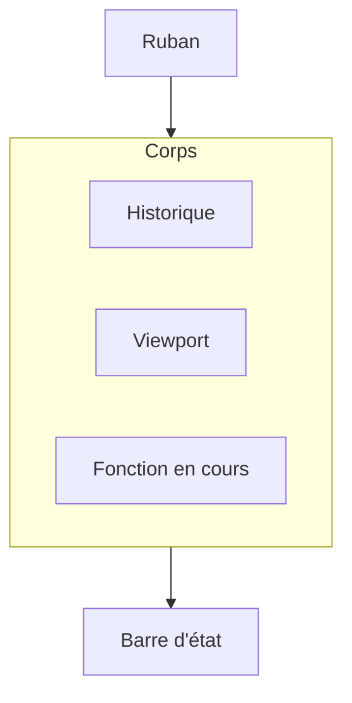

# Plan — layout de l’éditeur

Maquette statique, pas l’application. Elle montre où vivent les gestes décrits dans [le flux de construction](../veille/flux-construction-parametrique.md). Aucun outil de géométrie ni format de fichier n’est choisi ici.

Le sprint qui produit les fichiers est [sprint 01](../sprints/sprint-01-maquette-layout.md).

## Fichiers attendus

| Fichier | Rôle |
|---------|------|
| [index.html](index.html) | Structure des zones |
| [layout.css](layout.css) | Grille plein écran, thème sombre lisible |
| [README.md](README.md) | Rôle de chaque zone, et ce que la maquette ne fait pas |

## Zones

- **Ruban.** Onglets Esquisse, Fonctions, Assemblage. Esquisse est actif : ligne, cercle, coïncidence, cote. Fonctions liste extrusion, enlèvement, révolution, congé. Assemblage nomme les pièces suivantes sans commandes : lunette, verre, fond, couronne, maillons.
- **Historique**, à gauche. Origine et trois plans, puis la carrure dans l’ordre du fil rouge : esquisse anneau, extrusion, portée lunette, portée fond, cornes. « Esquisse anneau » est sélectionnée. Un curseur de reprise est dessiné sous la dernière ligne.
- **Paramètres**, sous l’historique. Liste courte : `diametre_boite`, `epaisseur_paroi`, `entrecorne`.
- **Viewport**, au centre. Repère et cube de vues (Dessus, Face, Droite). Le contenu est un schéma de l’anneau : deux cercles concentriques légendés `diametre_boite` et `epaisseur_paroi`.
- **Fonction en cours**, à droite. Titre « Extrusion — carrure ». Distance `hauteur_carrure`, sens. Le ruban lance la fonction. Ce panneau la règle.
- **Barre d’état.** « Esquisse entièrement contrainte », millimètre, pièce « Carrure ».

## Propositions

À montrer dans la maquette avec un marquage « proposition », pour les garder distinctes du cadre déjà fixé. On peut les retirer sans changer la grille.

- **Pastille de mode** dans le viewport : « Esquisse » ou « Solide ». En esquisse, le plan actif est nommé (Dessus) et le profil se lit en traits. En solide, on voit le volume. Le passage d’un mode à l’autre est le geste le plus fréquent du fil rouge.
- **Couleur du profil.** Trait bleu tant qu’un point peut encore bouger, trait blanc quand l’esquisse est entièrement contrainte. L’état n’est pas seulement une phrase dans la barre du bas.
- **Cotes sur le schéma**, dans le viewport, pas seulement dans le panneau : `Ø diametre_boite` sur le cercle extérieur, `epaisseur_paroi` entre les deux cercles.
- **Barre courte près de la sélection.** Après un clic sur le cercle : Coïncidence, Cote, Construction. Évite de quitter le dessin pour rejoindre le ruban.
- **Recherche de commande** dans le ruban. Un champ « Extrusion, cote, corne… ». Le ruban s’allonge dès que les maillons arrivent.
- **Fil d’Ariane** sous le ruban : Carrure / Esquisse anneau / Cercle extérieur. On sait ce qui est sélectionné quand les cornes et les portées se superposent.
- **Repère de symétrie** sur la ligne Cornes de l’historique : une seule esquisse, reportée à 6 h. On ne modélise pas quatre cornes séparées.
- **Coupe d’affichage** dans le cube de vues. Une demi-carrure montre la portée de lunette, la collerette et le trou de barrette, invisibles de l’extérieur sur les photos.
- **Aperçu fantôme** dans le panneau d’extrusion : la hauteur `hauteur_carrure` est déjà dessinée en trait fin avant confirmation. On juge l’épaisseur avant de valider la fonction.

## Hors de cette maquette

Pas de solveur, pas de WebGPU, pas de Dockview branché sur w3dts, pas de fichier OpenCAD. Un bouton montre seulement l’état visuel de l’outil actif.
