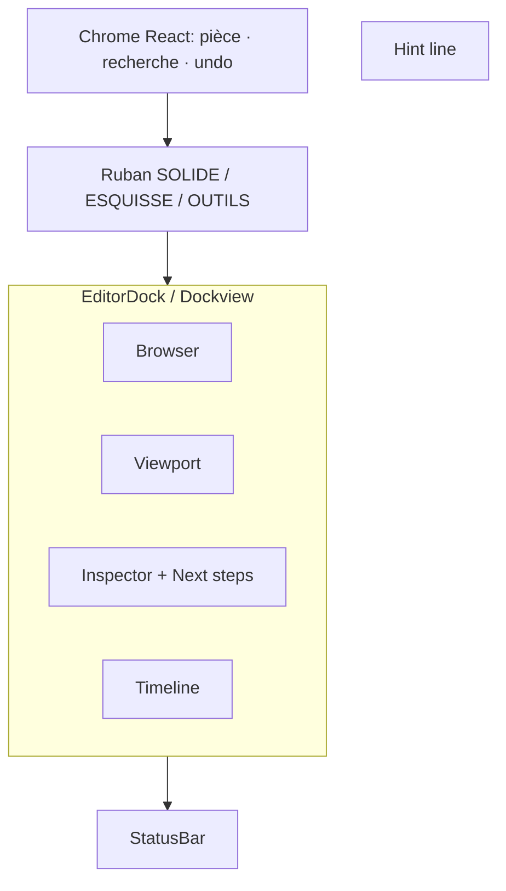

# Plan — maquette v2 (inspirée de Whittle)

Maquette **interactive (React)**, sans noyau. Elle montre où vivent les gestes et les messages du contrat [pilotage-lignes.md](../veille/pilotage-lignes.md). Elle n’exécute aucune ligne `Session`, n’appelle pas OCCT et n’écrit aucun fichier.

Référence comportementale : [Whittle](https://github.com/anand34577/whittle). Pas d’emprunt de pile Whittle (Three, replicad, `.whittle`). La pile UI est celle du shell OpenCad.

## Objectif

Remplacer la grille HTML « ruban CAD classique » de la v1 par une composition **guidée** dans **Dockview** : le prochain geste légal est lisible, l’illégal est grisé avec la raison, l’aperçu précède l’écriture dans le journal.

Scénario figé : **Carrure — Esquisse anneau** (cercle extérieur sélectionné, prêt pour cote / contrainte), avec un second état léger **Extrusion en cours** (aperçu fantôme, champ d’expression).

## Pile technique

Alignée sur [`packages/shell`](../../packages/shell) et [`shell/editor-ui.md`](../shell/editor-ui.md) :

| Couche | Choix |
|--------|--------|
| UI | **React 19** |
| Styles | **Tailwind CSS 3** + tokens CSS (design system) |
| Icônes | **lucide-react** |
| Layout panneaux | **Dockview** via `EditorDock` (`@naanouff/w3dts-editor-ui`) |
| Build | Vite (app dédiée sous `documentation/maquette/v2`) |

La maquette **conserve Dockview** : les zones ne sont plus une grille CSS fixe ; ce sont des panneaux dockables (timeline, paramètres, viewport, fonction, terminal / journal), comme le shell réel. On peut réarranger, flotter, empiler — le mockup doit rester lisible dans le layout par défaut.

### Design system

Mise en place d’un **design system OpenCad** (maquette = premier consommateur), pour que le shell puisse le reprendre ensuite.

| Couche | Contenu |
|--------|---------|
| Tokens | **Deux thèmes dès le départ : light (Paper) et dark** ; espacements, rayons, typo, états (hover / disabled / selected / danger / preview) ; bascule persistée (`localStorage`, même idée que `loadThemeFromStorage` du shell) |
| Primitives | `Button`, `IconButton`, `Tool` (actif / grisé + raison), `Hint`, `Field` (expression), `Badge`, `PanelSection`, `TimelineItem`, `StatusBar` |
| Icônes | Lucide uniquement (`Circle`, `Square`, `Move`, `Ruler`, `Undo2`, `Search`, …) — pas d’emoji, pas d’icônes SVG ad hoc sauf schéma viewport |
| Composition | Chrome, hint line, toolbar contextuelle, panneaux Dockview remplis avec les primitives |

Emplacement prévu des sources du design system (à trancher à l’implémentation, défaut ci-dessous) :

```
documentation/maquette/v2/src/
  ds/                 # tokens + primitives (premier jet)
  panels/             # contenu des panneaux Dockview
  App.tsx             # chrome + EditorDock + états A/B
```

Si le jet est stable, extraction ultérieure vers `packages/ui` ou extension de `@naanouff/w3dts-editor-ui` — **hors** done de la maquette v2.

## Organisation des dossiers

```
documentation/maquette/
  README.md                 # index des versions
  plan-v2.md                # ce plan
  v1/                       # existant (sprint 01), HTML/CSS inchangé
    index.html
    layout.css
    plan-layout.md
    README.md
  v2/                       # app React + Tailwind + Dockview
    package.json            # ou workspace package lié au monorepo
    vite.config.ts
    index.html
    plan-layout.md
    README.md
    src/
      main.tsx
      App.tsx
      tailwind.css
      ds/…
      panels/…
```

Actions de mise en place :

1. Déplacer `index.html`, `layout.css`, `plan-layout.md` et le contenu utile du README actuel vers `v1/`.
2. Réécrire le README racine pour pointer vers `v1/` (statique) et `v2/` (Vite).
3. Scaffold `v2/` (React, Tailwind, lucide-react, dockview / editor-ui).
4. Poser les tokens + primitives du design system.
5. Brancher `EditorDock` avec le layout par défaut et remplir les panneaux (mock data carrure).
6. Mettre à jour les liens dans `documentation/README.md`, journal, etc.

## Ce qu’on garde de la v1

| Élément | Rôle |
|---------|------|
| Zones de fond | historique, paramètres, viewport, réglage, barre d’état — **en panneaux Dockview** |
| Ruban lance / panneau règle | inchangé ([ruban.md](../veille/ruban.md)) |
| Scénario carrure | anneau, `diametre_boite`, `epaisseur_paroi`, `entrecorne` |
| Marquage « proposition » | idées encore optionnelles, retirables sans casser la grille |
| Contrat lignes | UI cliente ; aucune mutation réelle |

## Emprunts Whittle → zones v2

| Comportement Whittle | Traduction maquette OpenCad |
|----------------------|-----------------------------|
| Hint line (prochain geste) | Bandeau sous le chrome : « Choisissez une cote ou une coïncidence — ou Extruder si le profil est fermé » |
| Outils indisponibles expliqués | `Tool` grisé + tooltip Lucide / pastille « Il faut un profil fermé » |
| Preview bleu / vert / rouge | Anneau fantôme + volume d’extrusion (bleu = nouveau corps) |
| Formules partout | `Field` expression : `hauteur_carrure`, `40 mm`, `diametre_boite / 2` |
| Timeline + rollback | Panneau Construction Dockview + curseur de reprise |
| Panneaux compactables | **Dockview** (collapse / onglets / float) — pas une réinvention |
| Ctrl+K command palette | Champ recherche dans le chrome (`Search` Lucide) |
| Densité plus basse | Toolbar contextuelle courte + hint ; ruban allégé |

Hors maquette (reste décisions produit) : onboarding first-run, assistant IA, mates, mise en plan, thèmes au-delà de light/dark (accents multiples, density, reduced motion).

## Layout v2 (Dockview)



Layout calqué sur Whittle (capture de référence) :

| Zone | Position | Contenu mock |
|------|----------|--------------|
| Chrome | haut | Logo, fichier, undo, Carrure, Ctrl+K, thème |
| Ruban | sous chrome | Onglets + groupes d’icônes ; outils grisés avec raison |
| Browser | gauche | Paramètres, Origine, Vues, Corps, Esquisses + œil |
| Viewport | centre | Anneau, cube de vues, barre flottante Tout/Corps/Face/Arête |
| Inspector | droite | Modèle, expression, **Prochaines étapes** (hint Whittle) |
| Timeline | bas | Historique horizontal + reprise |

Le hint Whittle vit dans l’inspector (**Prochaines étapes**), pas en bandeau séparé.

### Ruban

| Onglet | Outils | Grisés (raison) |
|--------|--------|-----------------|
| ESQUISSE | Ligne, Cercle, Rectangle, Coïncidence, Cote | Extruder (« profil ouvert ») |
| SOLIDE | Extruder, Enlever, Congé, … | Congé (« choisissez une arête ») |

Pas d’onglet Assemblage (aligné sprint 60).

## États à dessiner

| État | Contenu |
|------|---------|
| A (défaut) | Esquisse anneau, cercle sélectionné, hint cote/extrude |
| B | Extrusion en cours : panneau Fonction + fantôme bleu |

Bascule : contrôle React simple (segmented control dans le chrome ou StatusBar) — mock UI only.

## Thèmes (light + dark)

Deux thèmes livrés avec la maquette v2 — pas un bonus :

| Thème | Rôle |
|-------|------|
| **dark** (défaut) | Charte openCAD : navy `#0E1423`, cyan marque `#22D3EE`, orange Editor `#F59E0B` |
| **light** | Variante planche sur fond clair : papier froid, cyan UI, orange Editor pour les CTA |

Mécanique :

- Tokens CSS en variables (`--oc-bg`, `--oc-panel`, `--oc-text`, `--oc-accent`, `--oc-preview`, …) sous `[data-theme="light"]` et `[data-theme="dark"]` (ou classe sur `html`).
- Tailwind mappe ces tokens (`bg-oc-panel`, `text-oc-muted`, …) — **pas** de couleurs en dur dans les panneaux.
- Bascule dans le chrome (icône Lucide `Sun` / `Moon`) ; préférence lue/écrite en `localStorage`.
- Dockview / `EditorDock` suit le même thème (styles editor-ui + override tokens OpenCad si besoin).
- Aperçu bleu / vert / rouge et états disabled restent **sémantiques** (lisibles dans les deux thèmes).

Thèmes supplémentaires (accent, density, system) : hors v2 ; les tokens sont déjà structurés pour les accueillir plus tard.

## Direction visuelle

- Light Paper + dark éditeur, même hiérarchie et densités.
- Tailwind pour la composition ; **pas** de classes magiques hors tokens (`bg-[…]` ad hoc limité).
- Pas de violet / glow / cards décoratives.
- Densité aérée ; une composition éditeur, pas un dashboard.

## Fichiers livrables v2

| Fichier / dossier | Rôle |
|-------------------|------|
| `v2/plan-layout.md` | Zones, panneaux Dockview, états |
| `v2/README.md` | Lancer (`pnpm dev`), rôle, hors scope |
| `v2/src/ds/` | Design system (tokens + primitives) |
| `v2/src/panels/` | Contenu mock des panneaux |
| `v2/src/App.tsx` | Chrome + Hint + EditorDock + états |

## Hors de cette maquette

Solveur, WebGPU / viewport w3dts réel, `.cadom` / `.cadompart`, MCP, Electron, assemblage, extraction packagée du DS vers un paquet publié, sync layout avec le store shell de production.

Dockview **est dans le périmètre** (layout réel). Le viewport reste un **mock** (SVG / placeholder), pas le moteur WebGPU.

## Critères de done

- [x] `v1/` contient l’ancienne maquette HTML ouvrable.
- [x] `v2` démarre en Vite (`pnpm dev`) avec React + Tailwind + lucide-react.
- [x] Dockview / `EditorDock` affiche le layout par défaut (Construction, Paramètres, Viewport, Fonction, Journal).
- [x] Design system : tokens + au moins les primitives listées, utilisées par les panneaux.
- [x] Thèmes **light** et **dark** basculables, persistés, sans couleur en dur dans les panneaux.
- [x] Hint + outils grisés avec raison + aperçu hors journal visibles.
- [x] États A / B basculables.
- [x] README racine `maquette/` et liens doc à jour.
- [x] Aucun appel Session / OCCT / worker.

## Ordre d’exécution (après validation)

1. Déplacer l’existant → `v1/`, ajuster chemins.
2. Scaffold `v2` (Vite React, Tailwind, lucide, dockview / editor-ui).
3. Poser `src/ds/` (tokens light/dark + primitives).
4. Brancher `EditorDock` + panneaux mock + chrome / hint / toolbar.
5. États A/B + bascule thème light/dark (persistée).
6. `plan-layout.md` + README ; liens doc + ligne journal.
7. Relecture visuelle dans les deux thèmes.
