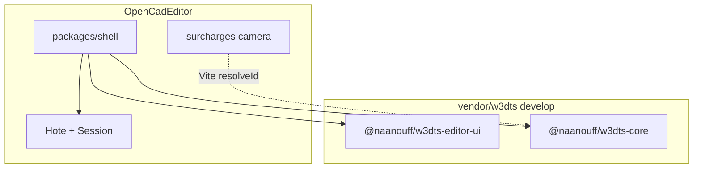

# Shell : chrome `@naanouff/w3dts-editor-ui`

Le chrome éditeur ne vient plus d’une grille HTML dans `packages/shell`. Il vient de [`@naanouff/w3dts-editor-ui`](https://github.com/naanouff/w3dts/tree/develop/packages/editor-ui) (Dockview, thème, `EditorDock`, primitives). Les panneaux métier restent dans OpenCadEditor. Le store et les panneaux Unity de `@naanouff/w3dts-viewer-editor` ne sont pas repris.

Le sprint qui le branche est [sprint 15](../sprints/sprint-15-editor-ui.md). Le socle domaine (`Hote`, registres, port viewport) reste celui de [plan.md](plan.md).

## Sous-module

`vendor/w3dts` suit la branche `develop` de [w3dts](https://github.com/naanouff/w3dts). C’est là que vit `packages/editor-ui`. Le pin du gitlink OpenCadEditor pointe ce commit.

## Surcharges caméra

Deux comportements sont spécifiques à OpenCadEditor. Ils ne modifient pas `vendor/` :

- `mat4.orthoZO` pour la profondeur orthographique WebGPU
- `setViewUp` / `keepViewUp` pour figer le haut de caméra en vue d’esquisse

Ils vivent dans `packages/shell/src/surcharges/`. Un plugin Vite redirige les modules `w3dts-core` correspondants vers ces fichiers.

## Host React

- Styles : `@naanouff/w3dts-editor-ui/styles.css` (tokens + Dockview) **avant** le premier rendu
- Tailwind : `src/tailwind.css` scanne `src/` et `vendor/w3dts/packages/editor-ui/src` (primitives)
- Thème : `loadThemeFromStorage`, `applyResolvedThemeToDocument`, `subscribeResolvedTheme`
- `EditorDock` : clé `opencad.shell.dockview.layout.v4`, panneaux requis `viewport`, `terminal`, `parametres`, `historique`, `document`, `debug`
- Layout par défaut : construction à gauche, paramètres sous l’arbre, document sous les paramètres, viewport au centre, terminal en bas
- Panneaux métier : tokens CSS + primitive `Panel` (pas le store `viewer-editor`)
- Terminal : Monaco comme le Script panel w3dts (`Entrée` exécute, `Maj+Entrée` nouvelle ligne, ↑ historique)
- Construction : arbre de `session.historique()` (pièce → paramètres / esquisses / fonctions)
- Document : auteur, version semantique, unité et repère de référence (`session.document()`)
- Debug : bouton **Build carrure** (`scriptCarrure.ts`)

`Hote` et les tests Vitest restent hors React. La page Vite est le consommateur UI.

## Hors de ce plan

Ruban, historique Dockview, Electron, upstream des surcharges caméra dans w3dts, consommation de `@naanouff/w3dts-viewer-editor`.
