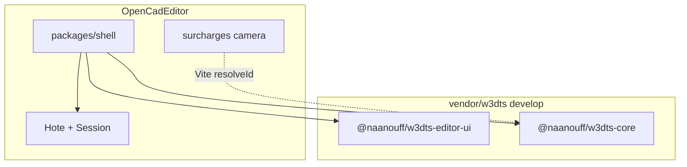

# Shell : chrome `@naanouff/w3dts-editor-ui`

Le chrome éditeur ne vient plus d’une grille HTML dans `packages/shell`. Il vient de [`@naanouff/w3dts-editor-ui`](https://github.com/naanouff/w3dts/tree/develop/packages/editor-ui) (Dockview, thème, `EditorDock`, primitives). Les panneaux métier restent dans OpenCadEditor. Le store et les panneaux Unity de `@naanouff/w3dts-viewer-editor` ne sont pas repris.

Le sprint qui le branche est [sprint 15](../sprints/sprint-15-editor-ui.md). Le socle domaine (`Hote`, registres, port viewport) reste celui de [plan.md](plan.md).

## Sous-module

`vendor/w3dts` suit la branche `develop` de [w3dts](https://github.com/naanouff/w3dts). C’est là que vit `packages/editor-ui`. Le pin du gitlink OpenCadEditor pointe ce commit.

## Surcharges caméra

Deux comportements sont spécifiques à OpenCadEditor. Ils ne modifient pas `vendor/` :

- `mat4.orthoZO` pour la profondeur orthographique WebGPU
- `setViewUp` / `keepViewUp` pour figer le haut de caméra en vue d’esquisse

Ils vivent dans `packages/shell/src/surcharges/`. Un plugin Vite redirige les modules `w3dts-core` correspondants vers ces fichiers.

## Host React

- Styles : `@naanouff/w3dts-editor-ui/styles.css` (tokens + Dockview) **avant** le premier rendu, puis `src/tailwind.css` qui importe `src/ds/tokens.css` (charte OpenCad)
- Tailwind : `src/tailwind.css` scanne `src/` et `vendor/w3dts/packages/editor-ui/src` (primitives) ; classes `oc-*` mappées sur `--oc-*`
- Thème : OpenCad `light|dark` via `applyOcTheme` / `loadOcTheme` (`opencad.shell.theme`) ; bridge `--oc-*` → `--color-*` pour Dockview ; `EditorDock` reçoit `resolvedTheme` light/dark. Intégration : [plan-integration-shell.md](../maquette/plan-integration-shell.md)
- Chrome + ruban Lucide + StatusBar au-dessus / au-dessous du dock (sprints 68–69)
- `EditorDock` : clé `opencad.shell.dockview.layout.v6`, panneaux requis `viewport`, `browser`, `inspector`, `timeline`, `terminal`
- Layout par défaut (Whittle) : browser à gauche, viewport au centre, inspector à droite, timeline + terminal en bas (onglets)
- Browser : arbre de construction + paramètres + méta document ; Construction inchangée (interrupteurs, vue esquisse)
- Inspector : sélection, expression (`regle`), hints « prochaines étapes »
- Timeline : historique horizontal + `pointe` / fin
- Terminal : Monaco (`Entrée` exécute, `Maj+Entrée` nouvelle ligne, ↑ historique)
- Debug / préférences : composants encore enregistrés, hors layout requis (sprint 70)
- Pendant que le worker calcule le volume, le viewport affiche « Construction… »

`Hote` et les tests Vitest restent hors React. La page Vite est le consommateur UI.

## Hors de ce plan

Ruban, historique Dockview, Electron, upstream des surcharges caméra dans w3dts, consommation de `@naanouff/w3dts-viewer-editor`.
