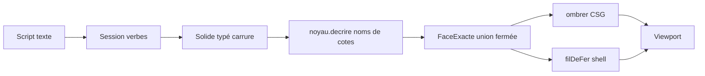

# Généricité du shell de génération 3D

Critique de l’état au 2026-09-26. Le découpage utile n’est pas « shell contre API ». C’est l’hôte d’affichage contre le compilateur de pièce. Le premier tient. Le second est calibré sur une seule pièce : la carrure Milgauss / Oyster, chargée par le bouton Debug de `packages/shell/src/DebugVue.tsx` via `SCRIPT_CARRURE` dans `packages/shell/src/scriptCarrure.ts`.

Le socle du shell reste [plan.md](plan.md). Cette note constate où la génération a quitté ce socle.

## Ce qui est déjà générique

- `Hote` (`packages/shell/src/hote.ts`) et `Panneau` (`packages/shell/src/types.ts`) : enregistrement de panneaux, journal, annulation. Aucune géométrie de montre.
- `Session.enregistrer` (`packages/api-parametrique/src/session.ts`) : verbes et handlers par domaine. Un nouveau domaine se branche sans toucher l’hôte.
- L’arbre (`packages/shell/src/arbreConstruction.ts`) et le panneau Paramètres lisent l’historique et la map de paramètres, sans connaître les cotes.
- `packages/api-parametrique/src/volumes.ts` (`boite`, `prisme`, `cylindre`) et `packages/api-parametrique/src/csg.ts` sont des primitives réutilisables. `ombrer` s’en sert. Le langage, lui, ne les expose pas.

## Où la généricité s’arrête

### 1. Le solide n’est pas un solide

`Solide` dans `packages/api-parametrique/src/types.ts` ne porte pas de géométrie. Il compte des extrusions et empile trois `Ajout` fermés : `rectangle`, `profil` (cotes Oyster : `largeurBout`, `plongeeBout`, `amorceDessus`), ou `cercle` sur `plan.3h`. `FaceExacte` est la même union fermée : cylindre, couronne, boîte, et deux faces nommées pour la montre (`racine`, `conge`), avec `plan` et `elevation` commentés « Oyster ».

Ajouter une poche rectangulaire, un congé arbitraire ou un second tube ne passe pas par un nouveau verbe. Il faut étendre l’union, puis `noyau.decrire`, puis `ombrer`, puis `filDeFer`.

### 2. L’esquisse est un motif, pas une géométrie

`profil` dans `packages/api-parametrique/src/domaines/solide.ts` ne résout pas les segments. Il compte : 3 segments et 1 arc donnent le profil Oyster ; 2 segments et 1 arc donnent le même profil sans rayon de racine ; un rectangle donne une boîte ; un cercle sur `plan.3h` donne le tube. Les cotes d’élévation (`rayon_bout_haut`, `plongee_bout`, `epaisseur_bout`, `amorce_dessus`) sont lues par nom de paramètre. Elles sont absentes du dessin.

Les plans autorisés sont figés : `plan.dessus`, `plan.12h`, `plan.3h` (`packages/api-parametrique/src/domaines/esquisse.ts`). `symetrie` est un verbe d’historique. `figures` dans `packages/api-parametrique/src/noyau.ts` pose toujours quatre cornes (signes ±x, ±z) et un tube à 3 h. `poser` ne renvoie que des cercles : segments et arcs n’atteignent jamais le viewport.

### 3. `decrire` recompile le script de carrure

`noyauProvisoire.decrire` évalue des noms fixes : `diametre_boite`, `epaisseur_paroi`, `hauteur_carrure`, `recul_barrette`. Le premier enlèvement borgne sur `face.dessus` devient la lunette, celui sur `face.dessous` le fond. `hauteurDuPlan` ne connaît que `face.dessus` à `hauteur_carrure`. Le domaine solide revérifie la collerette avec `profondeur_lunette` et `profondeur_fond`.

Une autre pièce, avec d’autres noms, produit une frontière vide ou fausse. `Session` injecte ce noyau en dur. L’interface `NoyauGeometrique` n’est pas un point d’extension utilisé.

### 4. Le shell retesselle ce que le noyau a déjà maillé

Deux chemins partent de la même `Frontiere` :

- Affichage solide : `session.maillage()` appelle `ombrer` (`packages/api-parametrique/src/ombre.ts`), qui connaît le plan, l’élévation et les congés.
- Filaire et repli : `documentCad` (`packages/shell/src/documentCad.ts`) appelle `filDeFer` (`packages/shell/src/dessin.ts`), qui importe `geometriePlan`, `pansDeCorne` et `congesDe`. Le repli `maillage(frontiere)` ne dessine qu’un cylindre complet, une boîte alignée sur les axes, une traverse et une couronne plate. Il ignore `plan`, `elevation`, `conge`, `racine` et `angleDeb`.

Le viewport n’utilise ce repli que si le maillage du noyau est vide. Les deux tesselleurs peuvent diverger. Le filaire du shell est devenu un second noyau de corne.

Autres couplages d’affichage, plus locaux : repères `plan.3h` et `plan.12h` dans `dessin.ts`, boîte caméra fixe et scène nommée `anneau` dans `packages/shell/src/viewportW3dts.ts`, classe `ProjetAnneau`.

### 5. L’hôte accumule, il ne décrit pas une scène

`Hote.ligne` pousse un maillage après chaque ligne, y compris si le terminal a avalé l’erreur. `panneauViewport` (`packages/shell/src/panneaux/viewport.ts`) empile ces clichés. L’UI React relit `session.frontiere()` et `session.maillage()`. Le panneau et le canvas ne partagent pas le même modèle. `Hote.executer` et `Session.executer` font le même travail.

## Conséquence

On peut changer les valeurs de la carrure sans toucher au code. On ne peut pas changer la pièce : toute forme hors du motif (anneau, quatre cornes, barrette à 12 h, tube à 3 h) demande une branche nouvelle dans le type, dans `decrire`, dans `ombrer` et dans `filDeFer`.

Le langage texte donne l’impression d’un modeleur : esquisse, cote, extrude, symétrie. L’évaluation réelle est une reconnaissance de la carrure, puis une émission de faces spécialisées.

La suite est dans [arbre-fonctions.md](../veille/arbre-fonctions.md). Le premier pas, l’arbre, est le [sprint 22](../sprints/sprint-22-arbre-fonctions.md).
