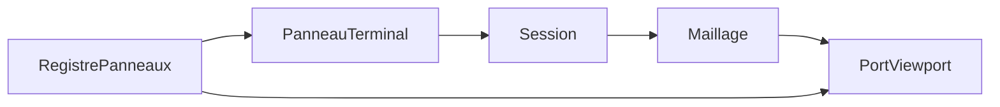

# Shell : terminal et viewport

Même règles que l’API : TDD ([developpement.md](../developpement.md)), registres, ports. Le socle ne contient pas de `switch` sur les panneaux. Le shell appelle `packages/api-parametrique`. Il ne possède pas l’historique.

Le sprint qui démarre ce socle est [sprint 04](../sprints/sprint-04-shell.md). Le paquet est `packages/shell`. L’écart entre ce socle et la génération actuelle est dans [genericite.md](genericite.md).

Le premier incrément est `packages/shell`, testé par Vitest, sans navigateur. Le canvas WebGPU est derrière le port viewport. Le chrome UI (Dockview, thème) est décrit dans [editor-ui.md](editor-ui.md) et branché par [sprint 15](../sprints/sprint-15-editor-ui.md) via `@naanouff/w3dts-editor-ui`.

## Socle

- **Hôte.** Tient une `Session`, la pile déjà dans l’API (`annuler`, `refaire`), et le registre de panneaux.
- **Panneau.** `{ id, faire, afficher }`. Le socle ne connaît pas les mots `terminal` ni `viewport`.
- **Terminal.** Envoie une ligne à `Session.commande`, affiche la ligne et l’erreur. Annuler et refaire passent par la pile existante.
- **Port viewport.** Reçoit un maillage `{ positions, indices }` ou vide. Un viewport de test enregistre les maillages reçus. Le canvas WebGPU sera une autre implémentation du même port.

## Maillage, avant le dessin

Le noyau provisoire ne pose que `face.dessus` et `face.dessous`. Le viewport n’a rien à montrer.

Le premier test rouge de `packages/api-parametrique` : après le script de la carrure, `maillage()` retourne un tube (deux rayons, une hauteur). `diametre_boite` à 42 mm change le rayon extérieur. Le noyau exact et w3dts restent hors de ce test.

## Ordre TDD

1. Test rouge : une ligne valide allonge l’historique ; une ligne inconnue s’affiche comme erreur sans casser la session ; annuler retire la dernière ligne du journal du terminal.
2. Code minimum du terminal et du registre.
3. Test rouge : `maillage()` décrit l’anneau.
4. Code minimum dans le noyau provisoire.
5. Test rouge : après le script, le viewport de test a reçu ce maillage ; une commande suivante le remplace.
6. Panneau viewport branché sur `maillage()`.

Hors de cet init : ruban, arbre, Electron, fichier OpenCAD, solveur réel. Dockview arrive avec [editor-ui.md](editor-ui.md), pas avec ce socle domaine.
