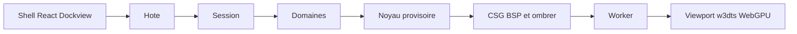

# Analyse d’OpenCadEditor

État au 2026-10-10. Synthèse du dépôt après les sprints 03–23. Le détail daté reste dans [journal.md](journal.md). Vérification du noyau externe : [occt-kernel.md](occt-kernel.md).

Éditeur CAO web qui doit exploiter les formats [OpenCAD](https://github.com/naanouff/OpenCAD) (`.cadom`, `.cadompart`, `.cadombrep`, `.cadomesh`). Le rendu vient du sous-module `vendor/w3dts`. Le grand projet est la boîte d’une Rolex Milgauss (carrure Oyster) ; une vis à tête fraisée Pozi sert de second cas.

Le code est un prototype qui reconstruit ces deux pièces. Ce n’est pas encore un éditeur de fichiers OpenCAD.

## Trois couches

- **[packages/api-parametrique](../../packages/api-parametrique)** — langage, historique, géométrie. Aucune dépendance runtime. Tests Vitest : 9 fichiers (`carrure`, `corne`, `csg`, `document`, `ombre`, `revolution`, `tesseler`, `tube-bout`).
- **[packages/shell](../../packages/shell)** — hôte, panneaux Dockview, terminal Monaco, viewport. Dépend de l’API et de React 19, Dockview, Monaco, Tailwind. Tests : 15 fichiers. `pnpm dev` via Vite.
- **`vendor/w3dts`** — moteur WebGPU (`develop`, commit noté `7a0651a9`). Chrome via `@naanouff/w3dts-editor-ui`. Les surcharges caméra restent dans [packages/shell/src/surcharges](../../packages/shell/src/surcharges), hors du sous-module.

Pas de `package.json` racine : chaque paquet a son propre `pnpm-lock.yaml`.

## Langage et session

[Session](../../packages/api-parametrique/src/session.ts) enregistre des domaines (`verbes` + `operations`). Une ligne de terminal devient une `Operation` réversible. `annuler` / `refaire` passent par une pile. `executer` / `lot` empilent les lignes puis ne reconstruisent le solide qu’une fois.

Domaines branchés :

- `parametres` — expressions vers millimètres
- `esquisse` — cercles, rectangles, segments, arcs, cotes, plans `dessus` / `12h` / `3h`
- `solide` — extrude, enlève, symétrie
- `revolution` — tourner un profil, puis `pas` pour l’hélice de filet (la vis)

Le document ([sprint 21](../sprints/sprint-21-document-repere.md)) porte auteur, version semver, unité `mm` et un repère fixe : origine au centre, X vers 3 h, Y vertical, Z vers 12 h. Les pièces et l’historique restent sur la session, pas dans le document. Aucun fichier `.cadom` / `.cadompart` n’est lu ni écrit.

## Géométrie : deux chemins

Le port `NoyauGeometrique` existe, mais `Session` injecte `noyauProvisoire` en dur. Ce n’est pas le noyau OpenCAD.

1. **Carrure** — `noyau.decrire` reconnaît des noms de cotes (`diametre_boite`, `hauteur_carrure`, …) et émet une `Frontiere` de faces exactes (cylindre, couronne, boîte Oyster, racine, congé). [ombrer](../../packages/api-parametrique/src/ombre.ts) tesselle à flèche ([tesseler](../../packages/api-parametrique/src/tesseler.ts)) puis rogne. Le fil de fer de la carrure vient encore des faces exactes dans le shell ([dessin.ts](../../packages/shell/src/dessin.ts)), qui réimporte `pansDeCorne`.
2. **Vis** — `revolution` et `pas` produisent un maillage (`Piece.volume`), unionné et creusé par un BSP maison ([csg.ts](../../packages/api-parametrique/src/csg.ts)). Le fil de fer lit les frontières de faces du maillage. Le calcul part dans un worker ([moteurWorker.ts](../../packages/shell/src/moteur/moteurWorker.ts)) ; l’UI affiche « Construction… ». Script vis : environ 12,3 s / 97 089 triangles avant optimisation, 1,7 s / 4 466 triangles après (journal, sprint 23).

Le type `Solide` ne porte pas une géométrie générale. Un ajout est un rectangle, un profil Oyster (cotes nommées), ou un cercle. Une forme hors de ce motif demande une branche dans le type, dans `decrire`, dans `ombrer` et dans `filDeFer`. Cette limite est écrite dans [genericite.md](../shell/genericite.md) et tient toujours après les sprints 21–23. La vis contourne le solide de carrure en posant un maillage à part ; elle n’ouvre pas un modeleur générique.

### Noyau B-Rep : occt-kernel (décision)

[@naanouff/occt-wasm](https://github.com/naanouff/occt-wasm) **v0.2.0** livre `occt-kernel` (primitives, extrude/revolve, booléens, fillet, tessellation, STEP/BREP). Preuves : [occt-kernel.md](occt-kernel.md).

**Décision 2026-10-10** ([noyau-occt.md](../veille/noyau-occt.md)) : ce kernel **remplace** le noyau OpenCAD comme moteur B-Rep d’OpenCadEditor. Formats inchangés ; historique hors bande. Sprint 24 : infra + preuve **vis** hybride. Sprint 25 ([pipeline-occt.md](../veille/pipeline-occt.md)) : historique → wires → `runBatch` (worker unique) ; vis dessus ; `pas` hybride. Carrure encore `noyauProvisoire` jusqu’à ce que le pipeline la couvre.

## Interface

[App.tsx](../../packages/shell/src/App.tsx) compose six panneaux Dockview (layout `opencad.shell.dockview.layout.v4`) :

- Viewport WebGPU (solide ombré, fil de fer, esquisse orthographique avec grille et cotes en glyphes)
- Construction — arbre origine → extrusion / enlèvement, esquisse enfant, cases activer/éteindre
- Paramètres — lecture seule
- Document — auteur, version, unité, repère
- Terminal Monaco (`opencad-commande`, Entrée exécute)
- Debug — boutons **Build carrure** et **Build vis** qui jouent [scriptCarrure.ts](../../packages/shell/src/scriptCarrure.ts) et [scriptVis.ts](../../packages/shell/src/scriptVis.ts)

La règle de développement est le TDD ([developpement.md](../developpement.md)) : test rouge, puis le minimum de code. La veille précède chaque sprint dans `documentation/veille/` et `documentation/sprints/`.

## Ce qui manque pour le produit annoncé

- Import / export OpenCAD (`.cadom` / `.cadompart`). STEP hors modèle de vérité.
- Sprint 25 : pipeline historique → wires → OCCT (**fait**).
- Sprint 26 : GCS amorcé (rectangle / cercle / profil ; statut UI).
- Sprint 27 préparé : pointe d’arbre ([pointe-arbre.md](../veille/pointe-arbre.md)).
- Naming topologique, paliers 3–4, carrure via pipeline générique seulement.
- Ruban, souris sur l’esquisse, Electron, assemblage multi-pièces.
- Un seul tesselleur (carrure encore faces exactes + `noyauProvisoire`).

## Lecture utile

- [journal.md](journal.md) — décisions datées
- [direction-modeleur.md](../veille/direction-modeleur.md) — verdict FreeCAD / Creo et pivot
- [pipeline-occt.md](../veille/pipeline-occt.md) — chaîne générique vers OCCT
- [occt-kernel.md](occt-kernel.md) — vérification v0.2.0
- [noyau-occt.md](../veille/noyau-occt.md) — OCCT remplace le noyau OpenCAD
- [sprint-24-noyau-occt.md](../sprints/sprint-24-noyau-occt.md) — infra + preuve vis
- [sprint-25-pipeline-occt.md](../sprints/sprint-25-pipeline-occt.md) — features génériques
- [sprint-26-gcs-esquisse.md](../sprints/sprint-26-gcs-esquisse.md) — solveur d’esquisse
- [genericite.md](../shell/genericite.md) — où le compilateur de pièce quitte le socle
- [api-architecture.md](../veille/api-architecture.md) — session, domaines, pile
- [shell/plan.md](../shell/plan.md) — hôte, panneaux, viewport
