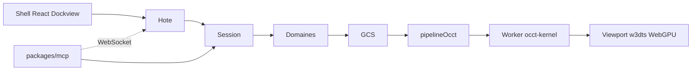

# Analyse d’OpenCadEditor

État au 2026-11-20. Synthèse après les sprints 03–61. Le détail daté reste dans [journal.md](journal.md). Cap et phases : [feuille-de-route.md](feuille-de-route.md). Vérification du noyau : [occt-kernel.md](occt-kernel.md).

Éditeur CAO web qui doit exploiter les formats [OpenCAD](https://github.com/naanouff/OpenCAD) (`.cadom`, `.cadompart`, `.cadombrep`, `.cadomesh`). Le rendu vient du sous-module `vendor/w3dts`. Le grand projet est la boîte d’une Rolex Milgauss (carrure Oyster) ; vis Pozi et boulon M8 servent de seconds cas.

Le code est un prototype qui reconstruit ces pièces via un **pipeline générique** (historique → GCS → OCCT). Ce n’est pas encore un éditeur d’assemblage `.cadom` complet.

## Quatre couches

- **[packages/api-parametrique](../../packages/api-parametrique)** — langage, historique, GCS, `noyauProvisoire` encore en secours. Aucune dépendance runtime.
- **[packages/format-opencad](../../packages/format-opencad)** — lecture et écriture `.cadompart` (protobuf OpenCAD `73473f6`).
- **[packages/mcp](../../packages/mcp)** — serveur stdio + pont WebSocket viewport (sprint 34).
- **[packages/shell](../../packages/shell)** — hôte Dockview, terminal Monaco, pipeline OCCT, worker. `pnpm dev` via Vite.
- **`vendor/w3dts`** — moteur WebGPU. Chrome via `@naanouff/w3dts-editor-ui`.
- **`vendor/occt-wasm`** @ v0.2.0 — sources ; artefacts dans `packages/shell/occt/`.

Pas de `package.json` racine : chaque paquet a son propre lockfile.

## Langage et session

[Session](../../packages/api-parametrique/src/session.ts) : domaines (`verbes` + `operations`), pile annuler / refaire, `lot` / `executer`. Document (sprint 21) : auteur, version semver, unité `mm`, repère fixe. Pointe de reconstruction (sprint 27). Datums d’origine (sprint 31).

Domaines : `parametres`, `esquisse` (dont polygones, GCS), `solide`, `revolution` (+ `pas` filet).

`.cadompart` : aller-retour via `format-opencad` (sprints 32–33), expressions et `pas`/`helix` compris. `.cadom` : ouvrir / plan / enregistrer / fetch injectable (sprints 44–47) ; decode mesh viewport pas encore. Dialecte expressions : cadompart v0.3 (O1).

## Géométrie

**Chemin principal** — historique compatible → polylines GCS → `pipelineOcct` → `runBatch` → tessellate (worker). Vis, boîte, carrure (anneau + poches + cornes), boulon M8. Filet `pas` encore **hybride** (maillage hôte + tête OCCT) faute d’hélice dans occt-kernel v0.2.0.

**Secours** — si l’historique ne compile pas pour OCCT, `noyauProvisoire` / BSP / `decrire` (carrure motif). Barrette et tube encore **ignorés** par le pipeline pour ne pas dégrader le corps. Retrait prévu en P1 ([feuille-de-route.md](feuille-de-route.md)).

**Décision moteur** — occt-kernel = bootstrap OpenCAD Kernel ([noyau-occt.md](../veille/noyau-occt.md)), pas un remplacement « hors produit ».

## Interface

[App.tsx](../../packages/shell/src/App.tsx) : viewport, Construction (arbre + pointe), Paramètres, Document (ouvrir `.cadompart` / `.cadom`, enregistrer selon le mode), Terminal Monaco, Debug (Build carrure / lunette / fond / verre / couronne / vis / boîte ; Load boîte .cadom). MCP peut piloter la session et, si le shell est ouvert, le viewport.

Décision du 2026-11-20 ([pilotage-lignes.md](../veille/pilotage-lignes.md)) : le terminal et le MCP sont l’interface par défaut. Le ruban et la souris émettent les mêmes lignes. L’écran ne devient pas un second modèle.

TDD : [developpement.md](../developpement.md). Veille avant chaque sprint.

## Ce qui manque pour le produit annoncé

- **P5** (en cours, sprint 62) — carreaux / arêtes / datums sélectionnables dans le viewport ([affichage-topologique.md](../veille/affichage-topologique.md)).
- **P6** — plateau de service OpenCAD : parts + instances + `.cadomat` ([plateau-service-cadom.md](../veille/plateau-service-cadom.md)).
- **W1** — arcs/cercles natifs, helix/sweep (occt-wasm).
- Restes P1 — delete BSP / `noyauProvisoire` ; Electron, mates, maillons hors moyen terme.

## Lecture utile

- [feuille-de-route.md](feuille-de-route.md) — phases et garde-fous
- [journal.md](journal.md) — décisions datées
- [direction-modeleur.md](../veille/direction-modeleur.md) — pivot
- [pilotage-lignes.md](../veille/pilotage-lignes.md) — ligne par défaut, UI cliente, emprunt fonctionnel à Whittle
- [affichage-topologique.md](../veille/affichage-topologique.md) — P5 viewport CAO
- [plateau-service-cadom.md](../veille/plateau-service-cadom.md) — P6 démo formats
- [sprint-62-carreaux-brep.md](../sprints/sprint-62-carreaux-brep.md) — prochain code
- [genericite.md](../shell/genericite.md) — où le compilateur de pièce quittait le socle
