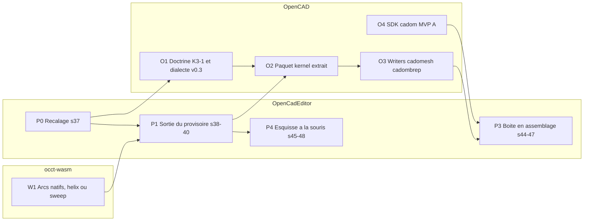

# Feuille de route — OpenCadEditor et OpenCAD

État au 2026-10-11. Synthèse après les sprints 03–36. Le détail daté reste dans [journal.md](journal.md). Cap technique : [direction-modeleur.md](../veille/direction-modeleur.md). Doctrine formats : [OpenCAD](https://github.com/naanouff/OpenCAD/blob/develop/documentation/opencad-doctrine.md).

## Cap

- **Modeleur paramétrique contraint générique** (FreeCAD / Creo web) : historique → GCS → wires → occt-kernel. Pas de compilateur de pièce.
- **Formats OpenCAD** : `.cadompart` (intention), `.cadom` (assemblage), `.cadomesh` (affichage), `.cadombrep` (solide exact figé). STEP hors vérité.
- **Pièces pilotes** : boîte Milgauss (carrure → lunette, verre, fond, couronne → maillons), vis, boulon M8.
- **Méthode** : veille avant sprint, TDD, gitflow `feature/*` → `develop` → `main`.

## État (2026-10-11)

**Fait, sur le cap** — Pipeline générique (sprints 25–31), vis et carrure sur OCCT (barrette / tube encore ignorés), `.cadompart` + `pas` (32–33), MCP (34), boulon (35), gitflow (36).

**Écarts** — Un test rouge (`tube-bout`) sans CI de tests ; `noyauProvisoire` / BSP encore dans `Session` ; doc en retard ; dérive d’axe (MCP, boulon, gitflow hors Milgauss) ; hygiène (branches locales, `pnpm-workspace.yaml` parasites).

**Arbitrages OpenCAD (retenus)**

| Sujet | Décision |
|-------|----------|
| Noyau K3 | OpenCAD Kernel = **occt-kernel en bootstrap** ; pipeline extrait de l’éditeur vers un paquet OpenCAD |
| Expressions | Dialecte versionné dans **cadompart v0.3** ; l’éditeur s’y conforme |

## Phases

| Phase | Dépôt | Sprints | Statut | Contenu |
|-------|-------|---------|--------|---------|
| **P0** Recalage | OpenCadEditor | [37](../sprints/sprint-37-recalage.md) | fait (PR #12) | Test, CI, doc, workspace, branches |
| **P1** Sortie du provisoire | OpenCadEditor | 38–43 | en cours (38–42 faits ; 43 découplage affichage ; reste delete provisoire / W1) | Barrette/tube OCCT, fillet, retrait `noyauProvisoire`, `polygone n` |
| **O1** Doctrine + dialecte | OpenCAD | — | à venir | K3-1 (occt-wasm, licence), cadompart v0.3, fermer #55 |
| **W1** Kernel WASM | occt-wasm | — | à venir | Arcs/cercles natifs, helix ou sweep (sinon filet cosmétique) |
| **O2** Paquet kernel | OpenCAD | — | à venir | Extraire pipeline + GCS ; entrée `CadompartFile` ; goldens K3-3…K3-5 |
| **O3** Writers | OpenCAD | — | à venir | `.cadomesh` (K3-7), `.cadombrep` (K3-8) |
| **O4** SDK `.cadom` | OpenCAD | — | à venir | MVP A : decode/encode, DAG, overrides |
| **P3** Assemblage | OpenCadEditor | 44–47 | à venir | Lunette/fond/verre/couronne + `.cadom` + Complete |
| **P4** Ergonomie | OpenCadEditor | 45–48 | à venir | Souris, sélection faces, ruban |

### P0 — Recalage (sprint 37)

Veille : [recalage-cap.md](../veille/recalage-cap.md). Sprint : [sprint-37-recalage.md](../sprints/sprint-37-recalage.md).

### P1 — Sortie du provisoire (sprints 38–40)

- Barrette et tube via OCCT (`plan.12h` / `plan.3h`).
- occt-wasm (W1) : arcs natifs, helix/sweep ou filet cosmétique.
- `fillet` / `chamfer` kernel + refs d’arêtes.
- Retrait de `noyauProvisoire`, BSP, `decrire`, `ombrer` du chemin `Session`.
- `polygone <n>` ; `hexagone` / `octogone` restent alias.

### Piste OpenCAD (parallèle dès P0)

- **O1** — Doctrine K3-1 ; cadompart v0.3 (dialecte d’expressions ; filet `thread` ou `helix` Required) ; fermer #55.
- **O2** — Paquet `kernel` : extraire `esquissePolylines`, `opsDepuisFonction`, `pipelineOcct`, GCS ; corpus boîte / vis / carrure / boulon ; éditeur consomme le paquet.
- **O3** — Writers `.cadomesh` et `.cadombrep` ; badges Required v0 puis Complete export v0.
- **O4** — SDK `.cadom` (prérequis P3).

### P3 — Boîte en assemblage (sprints 44–47)

Pièces `.cadompart` génériques ; `.cadom` + meshes late-load ; export Complete.

### P4 — Ergonomie (sprints 45–48)

Esquisse souris, sélection `face.*`, naming arêtes, ruban minimal. Hors moyen terme : maillons, Electron, mates.

## Garde-fous

1. Chaque veille nomme l’axe : modeleur générique, formats OpenCAD, ou pièce pilote. Après **deux** sprints hors axe Milgauss / formats → point de recalage.
2. **Interdits** : code propre à une pièce dans `decrire` / `Ajout` / `construireX` ; verbe mono-pièce ; champ de format hors spec publiée.
3. Test de conformité writer : `.cadompart` respecte la version de spec ; `expression` seulement si dialecte déclaré.
4. Proto et commit OpenCAD épinglés dans `format-opencad` ; vérifier l’écart en début de sprint.
5. CI verte avant merge. Mettre à jour [analyse.md](analyse.md) et cette feuille à chaque fin de phase.

## Lecture

- [analyse.md](analyse.md) — état du dépôt
- [direction-modeleur.md](../veille/direction-modeleur.md) — pivot FreeCAD / Creo
- [noyau-occt.md](../veille/noyau-occt.md) — occt-kernel bootstrap du kernel OpenCAD
- [recalage-cap.md](../veille/recalage-cap.md) — écarts P0
- [sprint-37-recalage.md](../sprints/sprint-37-recalage.md) — prochain code
