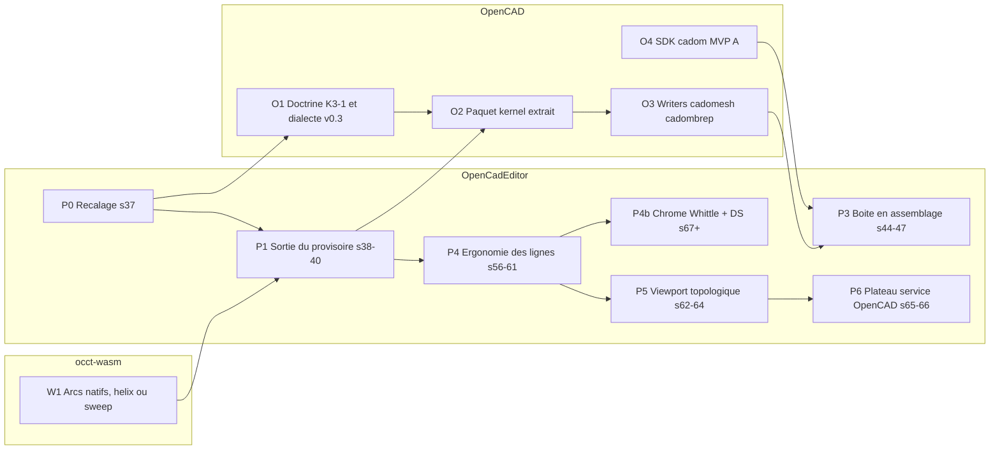

# Feuille de route — OpenCadEditor et OpenCAD

État au 2026-11-21. Synthèse après les sprints 03–61 ; P4b ouvert (sprint 67). Le détail daté reste dans [journal.md](journal.md). Cap technique : [direction-modeleur.md](../veille/direction-modeleur.md). Pilotage : [pilotage-lignes.md](../veille/pilotage-lignes.md) (2026-11-20). Doctrine formats : [OpenCAD](https://github.com/naanouff/OpenCAD/blob/develop/documentation/opencad-doctrine.md).

## Cap

- **Modeleur paramétrique contraint générique** (FreeCAD / Creo web) : historique → GCS → wires → occt-kernel. Pas de compilateur de pièce.
- **Formats OpenCAD** : `.cadompart` (intention), `.cadom` (assemblage), `.cadomesh` (affichage), `.cadombrep` (solide exact figé). STEP hors vérité.
- **Pièces pilotes** : boîte Milgauss (carrure → lunette, verre, fond, couronne → maillons), vis, boulon M8 ; démo formats : plateau de service (alu + poignées laiton + vis).
- **Pilotage** : la ligne de `Session` est l’interface par défaut. Terminal et MCP l’exécutent sans UI. Une interface future émet ou réécrit ces lignes et ne parle pas au noyau. Whittle est la référence des comportements, pas de la pile.
- **Méthode** : veille avant sprint, TDD, gitflow `feature/*` → `develop` → `main`.

## État (2026-10-11)

**Fait, sur le cap** — Pipeline générique (sprints 25–31), vis et carrure sur OCCT (barrette / tube encore ignorés), `.cadompart` + `pas` (32–33), MCP (34), boulon (35), gitflow (36).

**Écarts** — Un test rouge (`tube-bout`) sans CI de tests ; `noyauProvisoire` / BSP encore dans `Session` ; doc en retard ; dérive d’axe (MCP, boulon, gitflow hors Milgauss) ; hygiène (branches locales, `pnpm-workspace.yaml` parasites).

**Arbitrages OpenCAD (retenus)**

| Sujet | Décision |
|-------|----------|
| Noyau K3 | OpenCAD Kernel = **occt-kernel en bootstrap** ; pipeline extrait de l’éditeur vers un paquet OpenCAD |
| Expressions | Dialecte versionné dans **cadompart v0.3** ; l’éditeur s’y conforme |

## Phases

| Phase | Dépôt | Sprints | Statut | Contenu |
|-------|-------|---------|--------|---------|
| **P0** Recalage | OpenCadEditor | [37](../sprints/sprint-37-recalage.md) | fait (PR #12) | Test, CI, doc, workspace, branches |
| **P1** Sortie du provisoire | OpenCadEditor | 38–43 | fait (reste delete BSP / W1 helix) | Barrette/tube OCCT, fillet, découplage affichage, `polygone n` |
| **O1** Doctrine + dialecte | OpenCAD | — | fait ([PR #58](https://github.com/naanouff/OpenCAD/pull/58)) | K3-1, cadompart v0.3, #55/#53/#57 fermés |
| **W1** Kernel WASM | occt-wasm | — | à venir | Arcs/cercles natifs, helix ou sweep (sinon filet cosmétique) |
| **O2** Paquet kernel | OpenCAD | O2-1…15 | fait | `@opencad/kernel` ; extract éditeur (carrure / tube / pas) |
| **O3** Writers | OpenCAD | — | fait (K3-7/8) | `.cadomesh` / `.cadombrep` |
| **O4** SDK `.cadom` | OpenCAD | O4-1…3 | fait | MVP A : DAG, overrides, late-load, lint |
| **P3** Assemblage | OpenCadEditor | 44–47 | fait (graphe) | open/save/plan/fetch `.cadom` |
| **P3b** Pièces boîte | OpenCadEditor | 48–55 | fait | Pièces + Complete + octets/viewport `.cadomesh` |
| **P4** Ergonomie des lignes | OpenCadEditor | 56–61 | fait | Souris, ruban et expression : clients des lignes de `Session` |
| **P4b** Chrome Whittle + DS | OpenCadEditor | [67](../sprints/sprint-67-shell-ds.md)–[71](../sprints/sprint-71-shell-viewport-hints.md) | **fait** | Intégration maquette v2 → shell ([plan](../maquette/plan-integration-shell.md)) |
| **P5** Viewport topologique | OpenCadEditor | 62–64 | **en cours (62)** | Carreaux, arêtes, datums sélectionnables dans w3dts |
| **P6** Plateau service | OpenCadEditor | 65–66 | en cours (65) | Démo OpenCAD : plateau alu + 2 poignées laiton + 4 vis |

### P0 — Recalage (sprint 37)

Veille : [recalage-cap.md](../veille/recalage-cap.md). Sprint : [sprint-37-recalage.md](../sprints/sprint-37-recalage.md).

### P1 — Sortie du provisoire (sprints 38–40)

- Barrette et tube via OCCT (`plan.12h` / `plan.3h`).
- occt-wasm (W1) : arcs natifs, helix/sweep ou filet cosmétique.
- `fillet` / `chamfer` kernel + refs d’arêtes.
- Retrait de `noyauProvisoire`, BSP, `decrire`, `ombrer` du chemin `Session`.
- `polygone <n>` ; `hexagone` / `octogone` restent alias.

### Piste OpenCAD (parallèle dès P0)

- **O1** — Doctrine K3-1 ; cadompart v0.3 (dialecte d’expressions ; filet `thread` ou `helix` Required) ; fermer #55.
- **O2** — Paquet `kernel` : extrait (O2-1…15) ; éditeur consomme via `vendor/opencad` + ponts `historiqueKernel` / `gcsKernel`.
- **O3** — Writers `.cadomesh` et `.cadombrep` ; badges Required v0 puis Complete export v0.
- **O4** — SDK `.cadom` (prérequis P3) — fait (O4-1…3).

### P3 — Boîte en assemblage (sprints 44–47)

Sprint 44–47 : ouvrir / plan / enregistrer / fetch injectable ([fichier-cadom.md](../veille/fichier-cadom.md), [cadom-fetch-assets.md](../veille/cadom-fetch-assets.md)).

### P3b — Pièces de la boîte (dès sprint 48)

Sprint 48–55 : pièces + Design/Complete + octets/viewport `.cadomesh` ([assemblage-boite-cadom.md](../veille/assemblage-boite-cadom.md)).

### P4 — Ergonomie des lignes (sprints 56–61)

Sprints 56–58 : clic → `esquisse face.*` / cercle / rectangle ([selection-face-souris.md](../veille/selection-face-souris.md), [sprint-58](../sprints/sprint-58-esquisse-rectangle-souris.md)). Sprint 59 : noms `arete.*` et clic sur un milieu ([naming-aretes.md](../veille/naming-aretes.md)). Sprint 60 : ruban Esquisse / Fonctions ([ruban.md](../veille/ruban.md)). Sprint 61 : l’onglet Fonctions règle l’expression de la dernière fonction ([regler-fonction.md](../veille/regler-fonction.md)).

La souris et le ruban restent des clients des lignes ([pilotage-lignes.md](../veille/pilotage-lignes.md)). Pas de second modèle côté React. Les comportements empruntés à Whittle (geste refusé avec la raison, aperçu d’une ligne non écrite, référence ambiguë signalée) arrivent sur les verbes déjà dans le pipeline. Hors moyen terme : maillons, Electron, mates. W1 helix en parallèle occt-wasm.

### P4b — Chrome Whittle + design system (dès sprint 67)

Plan : [plan-integration-shell.md](../maquette/plan-integration-shell.md). Portage maquette v2 → shell terminé (sprints 67–71) : DS, chrome, ruban Lucide, layout Whittle + terminal, filtre viewport. Design seulement ; CAM / CTRL / Render restent maquette.

### P5 — Viewport topologique (dès sprint 62)

Veille : [affichage-topologique.md](../veille/affichage-topologique.md). Sprint 62 : carreaux BRep pick + surbrillance ([sprint-62-carreaux-brep.md](../sprints/sprint-62-carreaux-brep.md)). Sprint 63 : arêtes sur segments du fil BRep. Sprint 64 : datums / repères 3D visibles et pickables. Pick triangle sur `Maillage.faces[]` ; pas de GPU picking ni de pile Three.js.

### P6 — Plateau de service OpenCAD (dès sprint 65)

Veille : [plateau-service-cadom.md](../veille/plateau-service-cadom.md). Cas pédagogique : plateau aluminium, 2 instances de poignée laiton, 4 vis (2 par poignée). Sprint 65 : pièces `.cadompart`. Sprint 66 : assemblage `.cadom` Design/Complete + assets partagés + teinte alu/laiton (`.cadomat` → viewport). Transforms fixes ; mates hors scope. Prérequis : P5 sprint 62 au minimum.

## Garde-fous

1. Chaque veille nomme l’axe : modeleur générique, formats OpenCAD, ou pièce pilote. Après **deux** sprints hors axe Milgauss / formats → point de recalage.
2. **Interdits** : code propre à une pièce dans `decrire` / `Ajout` / `construireX` ; verbe mono-pièce ; champ de format hors spec publiée.
3. Test de conformité writer : `.cadompart` respecte la version de spec ; `expression` seulement si dialecte déclaré.
4. Proto et commit OpenCAD épinglés dans `format-opencad` ; vérifier l’écart en début de sprint.
5. CI verte avant merge. Mettre à jour [analyse.md](analyse.md) et cette feuille à chaque fin de phase.
6. Aucune mutation du modèle hors d’une ligne acceptée par `Session`. Ruban, souris, terminal et MCP partagent ce journal. Pas d’emprunt de replicad, de Three.js ni du format `.whittle`.

## Lecture

- [analyse.md](analyse.md) — état du dépôt
- [direction-modeleur.md](../veille/direction-modeleur.md) — pivot FreeCAD / Creo
- [pilotage-lignes.md](../veille/pilotage-lignes.md) — ligne de commande par défaut, UI cliente, emprunt fonctionnel à Whittle
- [noyau-occt.md](../veille/noyau-occt.md) — occt-kernel bootstrap du kernel OpenCAD
- [recalage-cap.md](../veille/recalage-cap.md) — écarts P0
- [affichage-topologique.md](../veille/affichage-topologique.md) — P5 viewport CAO
- [plateau-service-cadom.md](../veille/plateau-service-cadom.md) — P6 démo formats
- [sprint-62-carreaux-brep.md](../sprints/sprint-62-carreaux-brep.md) — P5 carreaux
- [plan-integration-shell.md](../maquette/plan-integration-shell.md) — P4b intégration maquette → shell
- [sprint-67-shell-ds.md](../sprints/sprint-67-shell-ds.md) — P4b phase 1 (DS)
