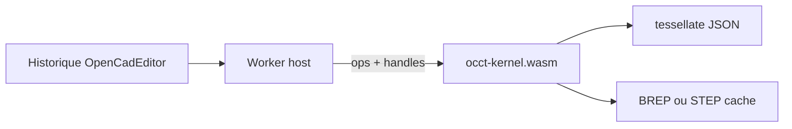

# Vérification : occt-wasm / occt-kernel

État au 2026-10-10. Corrige la lecture antérieure qui ne voyait dans [@naanouff/occt-wasm](https://github.com/naanouff/occt-wasm) qu’un lecteur STEP.

## Verdict

**Oui.** Le dépôt est à jour et expose un kernel de génération géométrique. La lecture « STEP-only » correspondait à **v0.1.0** (2026-10-09). **v0.2.0** (publiée 2026-10-10) ajoute `occt-kernel`.

## Preuves

- Release [v0.2.0](https://github.com/naanouff/occt-wasm/releases/tag/v0.2.0) : assets `occt-kernel.wasm` (~15,6 Mo) + `occt-kernel.js`, en plus de `occt-step.*`.
- `package.json` version `0.2.0`, exports `./step`, `./kernel`, `./kernel/batch`.
- Sources : `src/occt_kernel.cpp` + `src/kernel/` (`primitives`, `solids`, `topology`, `tessellate`, `io`, `arena`).
- Smoke documenté : `npm run smoke:kernel` (box, extrude-cut, revolve, fillet, BREP/STEP, batch) — `docs/release-v0.2.0.md` du dépôt.
- Typings : `types/occt-kernel.d.ts`.

## Surface API `occt-kernel` (v1 livrée)

| Famille | Ops |
|---------|-----|
| Primitives | `make_box`, `make_cylinder`, `make_sphere`, `make_cone` |
| Profil → solide | `make_wire_polyline`, `make_face_from_wire`, `extrude`, `revolve` |
| Booléens | `boolean_fuse`, `boolean_cut`, `boolean_common` |
| Filets | `fillet_edges`, `chamfer_edges` + `list_edges` / `list_faces` |
| Tessellation | `tessellate` (presets coarse/normal/fine) |
| Échange | `import_step` / `export_step`, `import_brep` / `export_brep` |

Doctrine alignée OpenCAD : historique paramétrique **hors** du module ; STEP/BREP = échange/cache ; PMI reste sur `occt-step`.

## Nuances

- Quelques docs internes du dépôt occt-wasm (`docs/occt-kernel.md` « constat », statut Phase 0 dans `kernel-api.md`) parlent encore d’un état antérieur ; le **README**, le **package 0.2.0** et la **release** font foi.
- Hors scope kernel : GCS / esquisse contrainte, feature tree, `TKOpenGl`, naming topologique avancé — l’hôte doit résoudre les wires.
- Ce n’est pas un remplacement du shell : c’est un candidat concret derrière le port `NoyauGeometrique` de [packages/api-parametrique](../../packages/api-parametrique/src/types.ts).

## Conséquence pour OpenCadEditor

Décision : [noyau-occt.md](../veille/noyau-occt.md). Le noyau OpenCAD est **déprécié** comme moteur ; **occt-kernel** est la cible. Sprint : [sprint-24-noyau-occt.md](../sprints/sprint-24-noyau-occt.md) — rapatrier le sous-module, brancher le worker, valider vis et carrure.

L’historique reste dans la `Session` / `.cadompart` ; le BREP exporté peut servir de cache (rôle `.cadombrep`). Vis hybride OCCT (sprint 24) ; carrure encore `noyauProvisoire` jusqu’au [pipeline générique](../veille/pipeline-occt.md).
