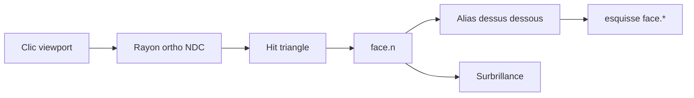

# Affichage topologique (viewport CAO)

Veille P5. Suite de [topo-faces.md](topo-faces.md), [selection-face-souris.md](selection-face-souris.md), [naming-aretes.md](naming-aretes.md) et [datums-origine.md](datums-origine.md). Sprint immédiat : [sprint-62-carreaux-brep.md](../sprints/sprint-62-carreaux-brep.md). Suite : 63 arêtes, 64 datums. Cap : [feuille-de-route.md](../suivi/feuille-de-route.md).

## Axe

Modeleur générique — le viewport lit le solide OCCT comme une CAO (carreaux, arêtes, datums), sans second modèle React et sans changer de pile (w3dts, occt-kernel, lignes Session).

## Constat

| Élément | Aujourd’hui | Cible P5 |
|---------|-------------|----------|
| Ombrage | Maillage tessellé, PBR gris unique | Inchangé en 62 (matériaux = P6) |
| Carreaux | `Maillage.faces[]` (id / triangle) sert au fil [`aretesBrep`](../../packages/shell/src/dessin.ts) | Pick + surbrillance du carreau |
| Faces nommées | `face.dessus` / `face.dessous` (bornes Y) | + `face.<n>` = index tessellate ; alias Y conservés |
| Pick face | Plan infini Y ([selectionFace.ts](../../packages/shell/src/selectionFace.ts)) | Ray × triangles du maillage |
| Arêtes | Milieu `list_edges` + seuil 3 mm | Sprint 63 : hit sur segments du fil BRep |
| Datums | Table [`datums.ts`](../../packages/api-parametrique/src/datums.ts) + arbre | Sprint 64 : plans / triad dessinés et pickables |

## Modèle (sprint 62)

| Élément | Décision |
|---------|----------|
| Source | `positions` / `indices` / `faces` du maillage OCCT affiché |
| Hit | Premier triangle le long du rayon (ortho NDC existant) ; id = `faces[tri]` |
| Nom | `face.<id>` ; si normale ≈ ±Y et Y extrémal → alias `face.dessus` / `face.dessous` |
| Support | `FaceSupport` : origine = barycentre du carreau, normale = moyenne des triangles |
| Face survolée / choisie | Le carreau lui-même prend la couleur : le solide est réparti en groupes de triangles (base / survol / sélection), un matériau par groupe, chaque triangle tracé une fois. |
| Arête survolée / choisie | Arête BRep entière (segments regroupés par paire de carreaux et connexité), tracée par la passe de lignes. Classe kernel (`arete.haut`…) conservée pour le ruban. |
| Couleurs | `couleursTopo.survol` / `.selection` dans `apparenceCad.ts`. |
| Action clic | Comme P4 : si support ouvre une esquisse → `esquisse <id>` via Session ; sinon sélection seule |
| Unités | Caméra m ; géométrie mm (`rayonVersMm` déjà en place) |

## Critères P5 (globaux)

1. Un carreau sous le curseur se distingue (surbrillance) et porte un nom stable au rebuild tant que la topo OCCT ne change pas d’index tessellate.
2. Les arêtes du fil BRep sont pickables sur le segment (63).
3. Les trois plans d’origine + axes sont visibles et pickables (64).
4. Toute mutation reste une ligne Session ([pilotage-lignes.md](pilotage-lignes.md)).

## Hors périmètre P5

GPU / ID-buffer picking ; courbes exactes kernel (W1) ; Exact `.cadombrep` ; mates ; teintes matériau (P6) ; Three.js / Whittle.

## Lecture

- [feuille-de-route.md](../suivi/feuille-de-route.md) — phases P5 / P6
- [plateau-service-cadom.md](plateau-service-cadom.md) — cas démo OpenCAD après P5
