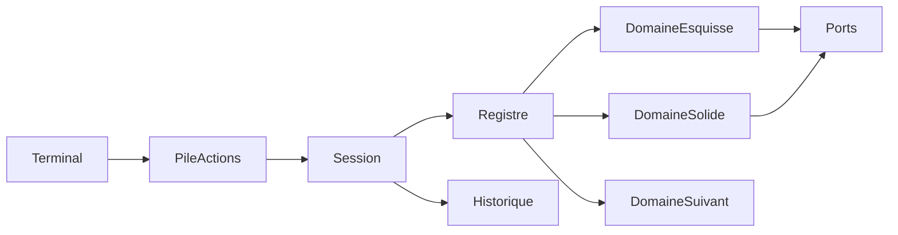

# Architecture de l’API paramétrique

Socle des commandes décrites dans [commandes-milgauss.md](commandes-milgauss.md). Le sprint qui l’implémente est [sprint 03](../sprints/sprint-03-api-carrure.md). Pas de viewport dans ce socle.

Le socle ne connaît pas l’extrusion, le cercle ni la révolution. Il connaît un document, des pièces, un historique d’opérations, une pile d’actions, et un registre de domaines. Ajouter un métier, c’est enregistrer un module.

## Objets stables

- **Document.** Plusieurs pièces. La carrure n’en utilise qu’une. L’assemblage plus tard place des pièces déjà reconstruites.
- **Pièce.** Nom, paramètres, historique ordonné, solide courant, esquisse ouverte.
- **Opération.** `{ domaine, type, arguments, noms }`. Une ligne du script devient une opération. `reconstruire` rejoue la liste.

Le registre associe `domaine + type` à une paire `faire` / `defaire`. `extrude` est `{ domaine: "solide", type: "extrude" }`. La session ne contient pas de `switch` sur ces types.

Chaque domaine publie un identifiant, ses opérations, et les ports dont il a besoin. Le contexte passé à chaque opération est fixe : pièce, paramètres, esquisse ouverte, solide courant, table des noms, et les ports. Un domaine nouveau lit ce contexte. Il n’y ajoute pas un champ que les autres devraient connaître.

## Pile d’actions

Toute commande du terminal est une action réversible. La pile est dans la session. Les domaines ne la connaissent pas.

- `faire` applique la commande et laisse de quoi l’annuler (opération ajoutée, ou ancienne expression d’un paramètre).
- `defaire` retire cet effet, puis `reconstruire` rejoue l’historique restant.
- Une commande nouvelle vide la branche « à refaire ».
- Annuler dépile vers cette branche. Refaire rappelle `faire`.

`evaluer`, `etatEsquisse`, `solideCourant`, `controlerCollerette` et `reconstruire` ne vont pas sur la pile.

`definirParametre` sur un nom déjà présent mémorise l’expression précédente. Les autres commandes de la carrure ajoutent une opération en fin d’historique : `defaire` retire cette opération.

## Domaines du lot carrure

- **parametres** — `definirParametre`, `evaluer`. Aucune géométrie.
- **esquisse** — `ouvrirEsquisse`, `ajouterCercle`, `ajouterRectangle`, `contraindreConcentrique`, `contraindreSymetrie`, `coter`, `etatEsquisse`.
- **solide** — `extruder`, `enlever`, `symetriserFonction`, `solideCourant`, `controlerCollerette`.

`creerPiece`, `nommer` et `reconstruire` restent dans la session.

## Ports

- **Évaluateur** — expression vers millimètres.
- **Solveur d’esquisse** — degrés de liberté, profil fermé, région entre deux cercles.
- **Noyau géométrique** — extrusion, enlèvement, faces adressables. Un noyau provisoire ou le noyau OpenCAD satisfont le même port.

## Domaines suivants

`arc`, `revolution` et `repete` s’ajoutent par de nouvelles opérations enregistrées. L’assemblage sera un domaine sur le document. Le terminal, la session, la pile et `reconstruire` restent en place.

Le viewport lira `solideCourant`. `@naanouff/w3dts-gproc` reste un graphe de maillage, hors de cet historique d’esquisse.
