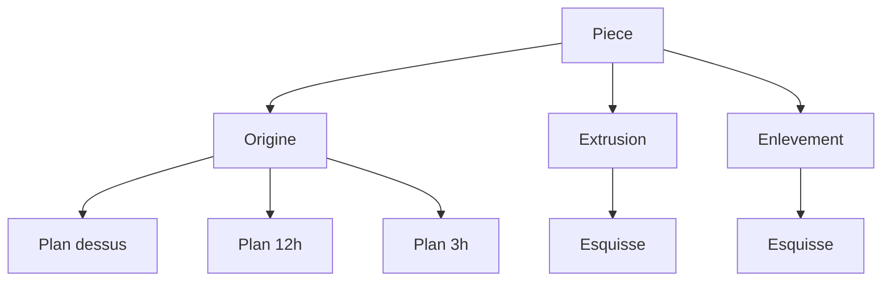

# Arbre de fonctions

Suite de [genericite.md](../shell/genericite.md). L’arbre actuel groupe les lignes du script : la pièce, les paramètres, puis l’esquisse qui avale l’extrusion. Creo et FreeCAD, notés dans [interfaces.md](interfaces.md), montrent des fonctions dans l’ordre de création. L’esquisse est accrochée à la fonction qui la consomme. Une origine et une pointe de reconstruction encadrent cette liste.

Le geste retenu est l’esquisse interne de Creo. Une esquisse nourrit exactement une fonction solide. L’esquisse réutilisable de FreeCAD, partagée par deux fonctions, vient après.

Le sprint qui code le premier palier est [sprint 22](../sprints/sprint-22-arbre-fonctions.md). Les paliers suivants restent ici. `SCRIPT_CARRURE` continue de construire la même frontière.

Hors de ces paliers : solveur 2D, réordonnancement, suppression, congé comme fonction, dialogue d’édition, remplacement de `filDeFer`.

## Palier 1 — L’arbre affiche des fonctions

`arbreConstruction` ne colle plus l’extrusion sous l’esquisse. `fonctions(historique)` regroupe les opérations.

- Origine : les trois plans du repère du document, `plan.dessus`, `plan.12h`, `plan.3h`. Pas encore des datums calculés.
- Une fonction par `extrude` ou `enlever`, dans l’ordre. Le libellé porte l’expression : `Extrusion 8`, `Enlèvement profondeur_lunette`.
- L’esquisse est l’enfant de cette fonction : le `esquisse` ouvrant, les entités et les cotes qui précèdent la fonction.
- Les `param` sortent de l’arbre. Ils restent dans le panneau Paramètres.

La géométrie ne change pas. Le test est dans `packages/shell/tests/arbre.test.ts`.

## Palier 2 — Pointe de reconstruction

La pièce porte une pointe : l’index de la dernière fonction rejouée. `reconstruire` s’arrête à cette fonction. Les suivantes restent dans l’historique et sont grisées dans l’arbre.

La commande `pointe` prend un rang, ou la fin. Annuler restaure la pointe précédente. Annuler une commande et déplacer la pointe sont deux gestes : l’un retire une ligne, l’autre régénère un préfixe.

Une pointe sur la première extrusion de la carrure laisse une frontière sans cornes ni tube. Une pointe à la fin rend la frontière d’aujourd’hui. `noyau.decrire` ne change pas de logique : il reçoit un historique tronqué, donc moins d’ajouts et d’enlèvements.

## Palier 3 — Chaque fonction porte son profil

`profil` dans `domaines/solide.ts` reconnaît la carrure en comptant segments et arcs. `noyau.decrire` relit `diametre_boite` et `hauteur_carrure`, et cherche le tube sur `plan.3h`.

À la régénération, chaque fonction évalue son esquisse et range le résultat sur l’opération, `Ajout` ou `Enlevement`. `decrire` parcourt ces contributions dans l’ordre.

- Deux cercles concentriques extrudés donnent l’anneau. Les rayons viennent de l’esquisse de cette extrusion, la hauteur de l’expression de la fonction.
- L’enlèvement borgne reste une poche sur la face de son esquisse. Le classement lunette ou fond reste celui déjà écrit : rayon entre la paroi et l’extérieur, ou sous le passage.
- Le profil de corne et le cercle de `plan.3h` gardent leurs évaluateurs, appelés sur l’esquisse de cette fonction.

`symetrie` reste dans l’esquisse de la fonction corne. Les quatre copies restent dans l’évaluateur de ce profil, jusqu’à une vraie transformation. Un second tube est une seconde fonction.

Le script de carrure donne la même frontière qu’avant ce palier. Un second `extrude` de cercle sur un plan latéral ajoute une traverse sans retirer la première.

## Palier 4 — Plans d’origine

Le jeu figé `plan.dessus`, `plan.12h`, `plan.3h` dans `domaines/esquisse.ts` devient les trois plans de l’origine, chacun avec le repère de [modele-document.md](modele-document.md). `esquisse plan.dessus` ouvre le plan XY du document. Une face de solide reste un support valide. `repere` dans `packages/shell/src/dessin.ts` lit ce repère.
