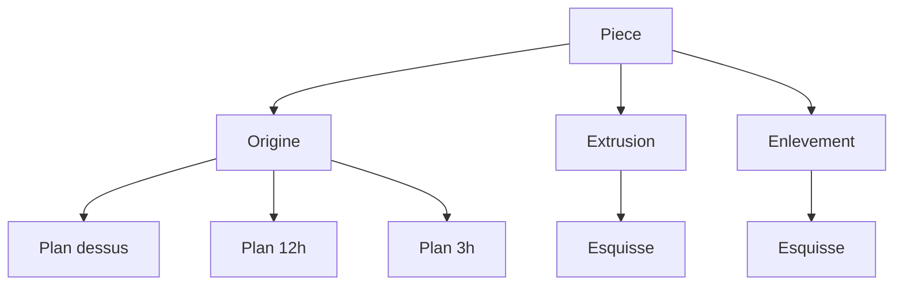

# Arbre de fonctions

Suite de [genericite.md](../shell/genericite.md). L’arbre actuel groupe les lignes du script : la pièce, les paramètres, puis l’esquisse qui avale l’extrusion. Creo et FreeCAD, notés dans [interfaces.md](interfaces.md), montrent des fonctions dans l’ordre de création. L’esquisse est accrochée à la fonction qui la consomme. Une origine et une pointe de reconstruction encadrent cette liste.

Le geste retenu est l’esquisse interne de Creo. Une esquisse nourrit exactement une fonction solide. L’esquisse réutilisable de FreeCAD, partagée par deux fonctions, vient après.

Le sprint qui code le premier palier est [sprint 22](../sprints/sprint-22-arbre-fonctions.md). Les paliers suivants restent ici. `SCRIPT_CARRURE` continue de construire la même frontière.

Hors de ces paliers : solveur 2D, réordonnancement, suppression, congé comme fonction, dialogue d’édition, remplacement de `filDeFer`.

## Palier 1 — L’arbre affiche des fonctions

`arbreConstruction` ne colle plus l’extrusion sous l’esquisse. `fonctions(historique)` regroupe les opérations.

- Origine : les trois plans du repère du document, `plan.dessus`, `plan.12h`, `plan.3h`. Pas encore des datums calculés.
- Une fonction par `extrude` ou `enlever`, dans l’ordre. Le libellé porte l’expression : `Extrusion 8`, `Enlèvement profondeur_lunette`.
- L’esquisse est l’enfant de cette fonction : le `esquisse` ouvrant, les entités et les cotes qui précèdent la fonction.
- Les `param` sortent de l’arbre. Ils restent dans le panneau Paramètres.

La géométrie ne change pas. Le test est dans `packages/shell/tests/arbre.test.ts`.

## Palier 2 — Pointe de reconstruction

**Fait** ([pointe-arbre.md](pointe-arbre.md), [sprint 27](../sprints/sprint-27-pointe-arbre.md)).

La pièce porte une pointe : l’index de la dernière fonction rejouée. `reconstruire` (Session et pipeline OCCT) s’arrête à cette fonction. Les suivantes restent dans l’historique et sont grisées dans l’arbre.

La commande `pointe` prend un rang, ou la fin. Annuler restaure la pointe précédente. Annuler une commande et déplacer la pointe sont deux gestes : l’un retire une ligne, l’autre régénère un préfixe.

## Palier 3 — Chaque fonction porte son profil

**Réinterprété** après [direction-modeleur.md](direction-modeleur.md) : plus d’enrichissement de `profil()` / `noyau.decrire` / `Ajout` typés pièce.

Chaque `extrude` / `enlever` / `revolution` consomme **son** esquisse résolue (GCS → wires) dans le replay OCCT (`pipelineOcct` + pointe). Deux cercles concentriques → anneau ; une poche sur `face.*` → cut ; un contour de corne → extrude + fuse. Un second tube est une seconde fonction sur le même pipeline.

Prérequis : [topo-faces.md](topo-faces.md), [gcs-enrichi.md](gcs-enrichi.md), [carrure-pipeline.md](carrure-pipeline.md). Finalisation / isolement du chemin motif : [sprint 31](../sprints/sprint-31-datums-origine.md).

## Palier 4 — Plans d’origine

Les trois plans `plan.dessus`, `plan.12h`, `plan.3h` deviennent les **datums** de l’origine, dérivés de `Session.document().repere` ([modele-document.md](modele-document.md)). Une seule table alimente la validation d’esquisse, `esquissePolylines`, `dessin.repere` et les nœuds Origine de l’arbre. Une face de solide reste un support valide (registre topo).

Plan : [datums-origine.md](datums-origine.md), [sprint 31](../sprints/sprint-31-datums-origine.md).
