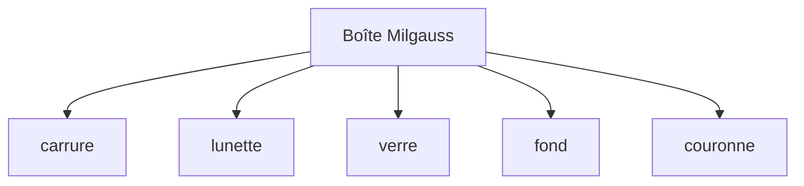

# Assemblage boîte `.cadom`

Sprint : [sprint-52-assemblage-boite-cadom.md](../sprints/sprint-52-assemblage-boite-cadom.md). Pièces : sprints 48–51. SDK : `@opencad/cadom`.

## But

Un document `.cadom` unit les cinq pièces de la boîte sous une racine « Boîte Milgauss ». Chaque nœud lie un asset `cadompart` (rôle parametric). Transforms locaux indicatifs (mm) — pas de solveur de mates.

## Viewport

À l’ouverture, le shell reconstruit chaque pièce connue (`SCRIPT_*` via OCCT), applique le `world` du nœud et fusionne dans `maillageAffiche`. Les URI non mappées restent hors vue.

## Hors périmètre

Lecture binaire des `.cadompart` assets, mates, Complete export.
