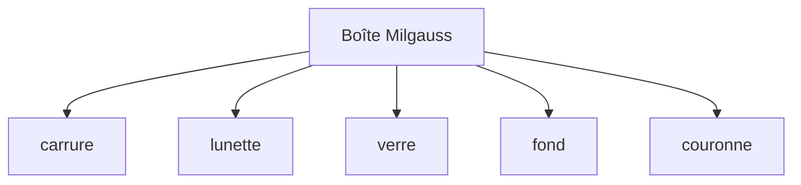

# Assemblage boîte `.cadom`

Sprints : [52](../sprints/sprint-52-assemblage-boite-cadom.md) (Design), [53](../sprints/sprint-53-assemblage-complete.md) (Complete bindings), [54](../sprints/sprint-54-assemblage-cadomesh.md) (octets mesh). Pièces : 48–51. SDK : `@opencad/cadom` + `@opencad/kernel/cadomesh`.

## But

Un document `.cadom` unit les cinq pièces sous « Boîte Milgauss ».

| Badge | API | Assets par pièce |
|-------|-----|------------------|
| Design | `assemblageBoiteMilgauss()` | `parametric` → `.cadompart` |
| Complete | `assemblageBoiteComplete()` | + `mesh` → `.cadomesh` |

Transforms locaux indicatifs (mm) — pas de mates. Les octets `.cadomesh` sont produits via `octetsCadomeshBoite()` (rebuild OCCT + `ecrireCadomesh`). Le viewport Complete utilise encore le rebuild scripts.

## Viewport

À l’ouverture, reconstruction des pièces connues (`SCRIPT_*`), transforms monde, fusion `maillageAffiche`.

## Hors périmètre

Zip multi-fichiers, affichage viewport depuis mesh seul, mates, Exact.
