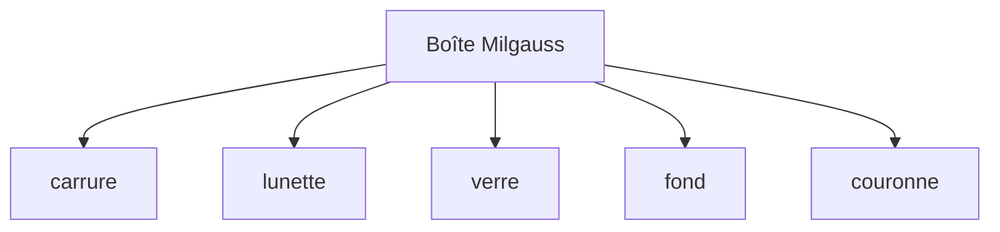

# Assemblage boîte `.cadom`

Sprints : [52](../sprints/sprint-52-assemblage-boite-cadom.md)–[55](../sprints/sprint-55-viewport-cadomesh.md). Pièces : 48–51. SDK : `@opencad/cadom` + `@opencad/kernel/cadomesh`.

## But

Un document `.cadom` unit les cinq pièces sous « Boîte Milgauss ».

| Badge | API | Assets par pièce |
|-------|-----|------------------|
| Design | `assemblageBoiteMilgauss()` | `parametric` → `.cadompart` |
| Complete | `assemblageBoiteComplete()` | + `mesh` → `.cadomesh` |

Transforms locaux indicatifs (mm) — pas de mates. Octets via `octetsCadomeshBoite()` ; viewport Complete via `maillageDepuisCadomesh` (decode + transforms). Fallback : rebuild scripts OCCT si pas d’octets mesh.

## Viewport

1. Si octets mesh chargés (statuts / map) → decode `.cadomesh` + transforms.
2. Sinon → rebuild `SCRIPT_*` + OCCT.

## Hors périmètre

Zip multi-fichiers, fetch HTTP mesh, mates, Exact.
