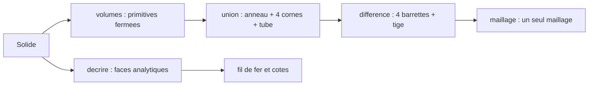

# Soustraction booléenne

Les cornes, la barrette et le tube sont dessinés par [cornes-barrette-tube.md](cornes-barrette-tube.md). Ils sont posés côte à côte, sans être réunis. La boîte d’une corne traverse l’anneau, le cylindre de barrette flotte dans le vide, le trou de tige s’arrête dans le tube. `decrire` dans [le noyau provisoire](../../packages/api-parametrique/src/noyau.ts) émet des faces ouvertes, et [documentCad.ts](../../packages/shell/src/documentCad.ts) les maille une par une. Ce lot calcule l’union et la différence. C’est le début du noyau géométrique annoncé dans [api-architecture.md](api-architecture.md). Le sprint qui le code est [sprint 13](../sprints/sprint-13-booleen-carrure.md).

Aucune dépendance nouvelle : un arbre BSP en TypeScript, dans le paquet d’API. Les deux paquets n’ont pas de dépendance de production hors `@opencad/api-parametrique`, et le réseau de l’entreprise coupe les installations.

## Volumes au lieu de faces

Un booléen demande des volumes fermés. `decrire` garde ses faces analytiques pour les cotes et pour le fil de fer. Une fonction nouvelle les rend en solides fermés, puis les combine.

La matière est l’anneau avec ses deux portées, les quatre boîtes des cornes, et le tube. Le vide est les quatre cylindres de barrette et le cylindre de tige. La tige traverse la paroi jusqu’au passage intérieur : son cylindre part du bout du tube et va jusqu’à l’axe.

## Modules

`csg.ts` porte l’arbre BSP sur une soupe de triangles : `union` et `difference`. Il découpe un triangle par un plan, classe devant, derrière et coplanaire, et retourne les normales pour la différence. Une tolérance nommée tient les faces coplanaires, par exemple une boîte tangente au cylindre.

`volumes.ts` rend chaque primitive en maillage fermé : le tube à portées, la boîte à six quadrilatères, le cylindre à deux couvercles. Les cylindres d’opération prennent moins de segments que l’affichage, pour tenir le coût du BSP.

`mailler` appelle `volumes`, puis l’union et la différence. `decrire` ne change pas.

## Arêtes

Le fil de fer vient des faces analytiques, donc il montre encore la boîte à travers l’anneau. `filDeFer` dans [dessin.ts](../../packages/shell/src/dessin.ts) lit le maillage booléen et garde les arêtes dont les deux triangles font un angle net. Les courbes d’intersection entre la corne et l’anneau apparaissent.

## Tests

Un fichier `csg.test.ts` part de deux cubes qui se recouvrent : l’union a le volume de la somme moins l’intersection. Un cube moins un cylindre central perd le volume de ce cylindre.

L’appariement des arêtes vaut pour les primitives : la boîte et le tube sortent fermés. Un résultat de BSP garde des sommets en T, une arête coupée d’un côté et entière de l’autre, donc ce critère ne s’applique pas au booléen. Sur un résultat, la mesure est le volume et l’absence de triangle plat.

Dans `carrure.test.ts`, après le script complet, aucun sommet de corne ne reste dans la matière de l’anneau, entre le passage et le rayon extérieur, sur la hauteur de la collerette. Le trou de tige débouche : des triangles de rayon 0,6 existent au rayon du passage. `param entrecorne 22` et `param diametre_boite 42` reconstruisent sans erreur.

Un test du shell vérifie que les arêtes vives portent le raccord corne-anneau : des segments verticaux sur la paroi, absents de l’anneau lisse.

## Ce que le sens de rotation impose

Le volume signé d’une boîte se calcule sur ses six faces. Une face enroulée à l’envers annule sa voisine, et le volume tombe au tiers de sa valeur. Un cylindre dont l’axe est au milieu du triplet change la main du repère : l’axe Y demande l’ordre inverse de l’axe X. Sans cette inversion, le BSP prend le dedans pour le dehors et la différence rend l’intersection.

## Risques

Le BSP est sensible aux faces coplanaires et au nombre de triangles. Les cylindres d’opération et la coque descendent à 24 segments : la paroi se lit à facettes. Si la reconstruction devient lente à chaque commande, le maillage booléen est calculé à la demande du viewport, pas dans `faire`.
