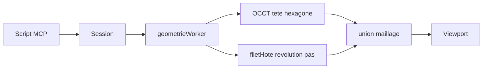

# Boulon hexagonal fileté

Suite de [mcp-geometrie.md](mcp-geometrie.md) et de [vis-maillage.md](vis-maillage.md). Sprint : [sprint-35-boulon-hexagonal.md](../sprints/sprint-35-boulon-hexagonal.md). Le pipeline hybride `pas` est dans [pipeline-occt.md](pipeline-occt.md).

## But

Un boulon M8 proche d’une pièce réelle : tête hexagonale cotée en entreplat, fût fileté sur toute la longueur, bout plat (sans pointe de vis à bois). Un agent le construit via le MCP ; l’éditeur ouvert montre le même solide.

`octogone` + `cote entreplat` existent déjà dans l’API ([`octogone.test.ts`](../../packages/api-parametrique/tests/octogone.test.ts)). Il manque le miroir à six pans, le rejeu OCCT des polygones, et un script qui n’emprunte pas la pointe 30° de [`scriptVis.ts`](../../packages/shell/src/scriptVis.ts).

## Écart constaté

Un essai MCP a produit une tête cylindrique (seconde révolution), une pointe ~12 mm (`angle_pointe 30`) et un filet qui s’amincit : `maillerFilet` borne la crête par `tan(angle_pointe / 2)` jusqu’à ce que le cône atteigne le Ø nominal.

| Attendu | Produit par erreur |
|---------|-------------------|
| Tête hexagonale (6 pans) | Tête de révolution |
| Bout plat | Longue pointe type vis à bois |
| Filet régulier sur le fût | Filet qui démarre en s’amincissant |

## Architecture



Ordre du script, aligné sur le hybride `pas` de [`pipelineOcct.ts`](../../packages/shell/src/occt/pipelineOcct.ts) :

1. Profil fût cylindrique + `revolution` + `pas` (filet hôte).
2. `esquisse face.dessus` + `hexagone` + `cote entreplat` + `extrude hauteur_tete` (tête OCCT).

Profil fût (âme dès `h = 0`) :

```
esquisse plan.12h
segment
cote rayon 0
cote hauteur 0
segment
cote rayon diametre_ame / 2
cote hauteur 0
segment
cote rayon diametre_ame / 2
cote hauteur longueur
segment
cote rayon 0
cote hauteur longueur
revolution
pas
```

Paramètres M8 : `diametre 8`, `diametre_ame 6.5`, `pas 1.25`, `angle_filet 60`, `angle_pointe 175` (run-in du filet inférieur au millimètre ; éviter 30°), `entreplat 13`, `hauteur_tete 5.5`, `longueur 30`.

## Verbe `hexagone`

Miroir de `octogone` : même cote `entreplat` (distance entre pans opposés). Six sommets, rayon `entreplat / (2 · cos(π/6))`, pans plats comme un écrou. `octogone` reste pour huit pans.

## Pipeline OCCT

Aujourd’hui le compilateur ne rejoue que `cercle`, `rectangle`, `segment`, `arc`, et `appliquerCote` ignore `entreplat` : un polygone ne produit pas de wire. Il faut :

- rejouer `hexagone` et `octogone`, appliquer `entreplat` ;
- après la première `revolution` (même sautée pour `pas`), poser `face.dessus` / `face.dessous` via `faceDepuisBornesY(0, yMax)` ;
- sur `extrude` de `face.dessus` / `face.dessous`, utiliser l’altitude et la normale de la face (plus `yPlan: 0` et `+Y` en dur).

## État

Palier codé sur `feature/boulon-hexagonal` : verbe `hexagone`, pipeline polygones / faces / extrude sur `face.dessus`, script MCP M8 hybride (`pas` + tête OCCT).

## Hors de ce palier

Filet ISO cosmétique ou hélice kernel OCCT (reste `maillerFilet`, facettes à 48 segments). Fermeture du bout en couronne plane (la naissance reste un éventail axial).
