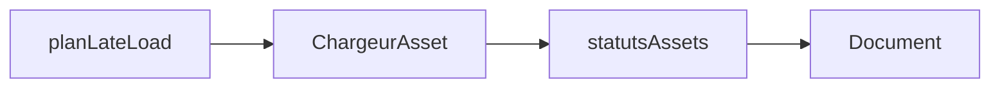

# Fetch assets `.cadom`

Suite de [cadom-late-load.md](cadom-late-load.md). Sprint : [sprint-47-cadom-fetch-assets.md](../sprints/sprint-47-cadom-fetch-assets.md).

## But

Exécuter le plan late-load via un chargeur injectable : octets en mémoire + statut par asset dans Document. Pas de décodage glb/cadomesh ni rendu viewport.

## Chargeur

`definirChargeur({ charger(uri) })` — défaut : `fetch(uri)`. Les tests injectent un mock (fixtures sans GLB réels).

## Hors périmètre

Decode mesh, fusion viewport, base directory File System Access, pièces Milgauss.
