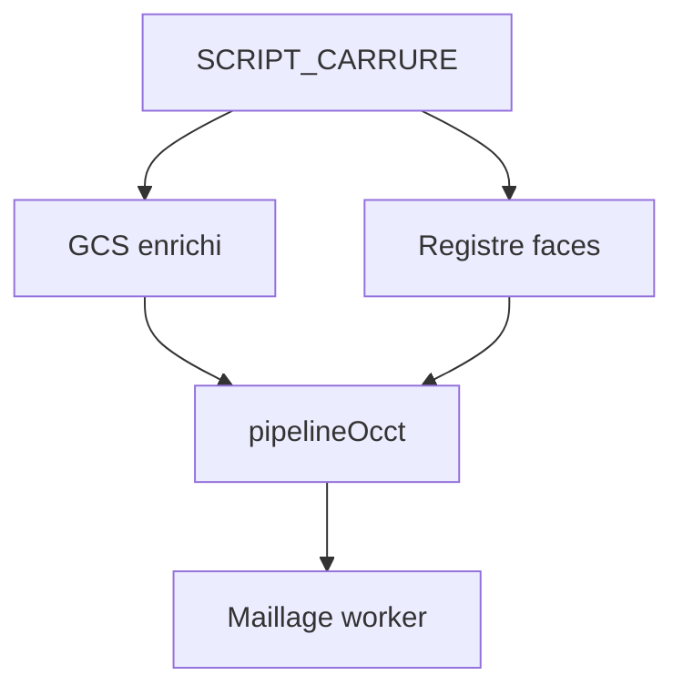

# Carrure sur pipeline OCCT

Plan pour l’item 6 de [direction-modeleur.md](direction-modeleur.md). Sprint : [sprint-30-carrure-pipeline.md](../sprints/sprint-30-carrure-pipeline.md). Dépend de [topo-faces.md](topo-faces.md) et [gcs-enrichi.md](gcs-enrichi.md).

## But

La carrure (préfixe anneau + poche(s) + cornes au minimum) passe par **historique → wires → OCCT**, comme la vis. Pas de second compilateur de motifs.

## Jalons

1. **Anneau** — deux cercles concentriques → extrude (+ cut intérieur) → paroi.
2. **Cuts** — lunette / fond sur `face.*` (sprint 28).
3. **Cornes** — wire GCS → extrude → fuse ; symétries dans le wire.
4. Barrette / tube — même sprint si le temps le permet, sinon suite ; le critère écran exige anneau + une poche + cornes.

## Interdit

- Enrichir `noyau.decrire` / `figures()` / `Ajout` typés pièce pour « porter » la carrure.
- Rejouer `construireVis`-style spécial carrure.

## Critères

1. `historiqueCompatibleOcct` accepte le script (ou le préfixe retenu).
2. Worker sert le maillage OCCT (pas `noyauProvisoire`) pour ce script.
3. Debug **Build carrure** : forme conforme (paroi, poche, cornes).

## État

Branché sur `feature/carrure-pipeline` (sprint 30) : anneau = extrude extérieur + cut intérieur ; poches `face.*` ; cornes GCS. Barrette (`plan.12h`) et tube (`plan.3h`) encore ignorés pour ne pas dégrader le corps. Worker OCCT si compilable.

## Hors périmètre

Élévation / congés de bout en 3D, barrettes et tube OCCT, naming topo avancé, retrait définitif de `noyauProvisoire` (sprint 31).
