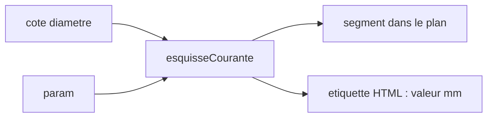

# Cotes dynamiques des esquisses

Les cercles cotés s’affichent dans le plan, avec leur diamètre en millimètres. La valeur suit l’expression : changer le paramètre change le nombre. Le sprint qui le code est [sprint 08](../sprints/sprint-08-cotes-esquisse.md).

Seuls les diamètres, pour commencer. Les cotes d’un rectangle (`ecart`, `debord`, `largeur`) restent après. w3dts n’a pas de texte. Le trait de cote passe par le fil déjà en place. Le nombre passe par un élément HTML au-dessus du canvas.

## La valeur

`esquisseCourante()` ne renvoie aujourd’hui que le rayon et l’altitude. Chaque cercle coté portera aussi `valeur`, le diamètre évalué en millimètres. L’expression reste sur l’entité. Au rebuild, `poser` la réévalue. `param diametre_boite 42` passe la cote de 40 à 42.

## Le trait

Une fonction pure dans `packages/shell` trace, dans le plan du cercle, un segment diamétral. L’ancre du texte est juste à l’extérieur, sur l’axe du plan. Ces segments vont dans un fil distinct. Les cercles restent bleus, la grille grise. Le maillage ne change pas.

## Le nombre

La page pose une étiquette par cote : `Ø` puis la valeur en millimètres. La position à l’écran vient de l’ancre et du cadrage de la vue de plan, la boîte de ±30 mm. Pas de nouvelle passe GPU. Hors esquisse, les étiquettes disparaissent.

Hors de ce lot : cotes de rectangle, cotes du solide en 3D, saisie à la souris, flèches et texte GPU.
