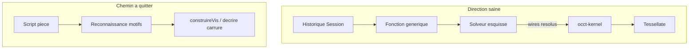

# Direction : modeleur paramétrique contraint

Décision du 2026-10-10. Fait suite à [noyau-occt.md](noyau-occt.md), [genericite.md](../shell/genericite.md) et [arbre-fonctions.md](arbre-fonctions.md).

## Verdict

**Oui sur l’architecture cible. Non sur la façon dont la géométrie est encore produite.**

Les piliers pour un FreeCAD / Creo web sont posés. Le cœur d’un modeleur **contraint** n’y est pas encore : rattraper la vis avec OCCT prouve le moteur B-Rep, pas le modèle paramétrique générique.

## Ce qui est déjà la bonne direction

| Pilier | État OpenCadEditor | Chez FreeCAD / Creo |
|--------|--------------------|---------------------|
| Historique = vérité | `Session` + opérations ([api-architecture.md](api-architecture.md)) | Feature tree / document |
| Noyau B-Rep hors document | **occt-kernel** ([noyau-occt.md](noyau-occt.md)) | OCCT / Granite / Parasolid |
| Arbre fonction ← esquisse | Palier 1 ([arbre-fonctions.md](arbre-fonctions.md)) | Esquisse enfant de la feature |
| Formats vs éditeur | `.cadompart` intention, STEP/BREP cache | Document natif ≠ STEP |
| UI shell générique | Hôte / Dockview / worker | Viewer ≠ kernel |

« OCCT calcule, l’historique reste hors bande » est le bon découpage.

## Ce qui bloque encore

Critique de [genericite.md](../shell/genericite.md), encore vraie après OCCT :

1. **Esquisse non contrainte** — pas de GCS ; les cotes ne résolvent pas un profil.
2. **Solide typé pièce** — `Ajout` = rectangle | profil Oyster | cercle.
3. **Évaluation par motif** — compter segments/arcs ou lire `diametre_boite`, ce n’est pas « extrude ce wire ».
4. **OCCT en spécialiste** — `construireVis.ts` rejoue la vis à part ; la carrure reste sur `noyauProvisoire`. Porter la carrure motif par motif reproduirait le compilateur Oyster avec un autre backend.
5. **Pas de naming topologique** — pas de face stable après rebuild.
6. **Pointe / édition** — palier 2 **fait** ; paliers 3–4 réinterprétés (sprints 30–31).

Sans GCS + features génériques → OCCT, le dépôt reste un **générateur paramétrique de deux pièces**, même avec un vrai B-Rep.

## Ordre d’arrivée vers FreeCAD / Creo

1. Esquisse résolue (polylines évaluées) + `extrude` / `revolution` / `enlever` → `runBatch` OCCT — [sprint 25](../sprints/sprint-25-pipeline-occt.md) (**fait**).
2. Remplacer `construireVis` spécial par ce pipeline (**fait**).
3. Solveur d’esquisse 2D (GCS) — [sprint 26](../sprints/sprint-26-gcs-esquisse.md) / [gcs-esquisse.md](gcs-esquisse.md) ; enrichissement — [gcs-enrichi.md](gcs-enrichi.md) / [sprint 29](../sprints/sprint-29-gcs-enrichi.md) (**fait**).
4. Pointe de reconstruction (arbre palier 2) — [pointe-arbre.md](pointe-arbre.md) / [sprint 27](../sprints/sprint-27-pointe-arbre.md) (**fait**).
5. Références topologiques (faces) — [topo-faces.md](topo-faces.md) / [sprint 28](../sprints/sprint-28-topo-faces.md) (**fait**).
6. Carrure via pipeline générique — [carrure-pipeline.md](carrure-pipeline.md) / [sprint 30](../sprints/sprint-30-carrure-pipeline.md) (**fait**).
7. Datums d’origine + palier arbre 3 — [datums-origine.md](datums-origine.md) / [sprint 31](../sprints/sprint-31-datums-origine.md) (**fait**).

## Arrêt d’investissement

- Porter `SCRIPT_CARRURE` vers OCCT comme la vis (hors sprint 24 restant).
- Enrichir `FaceExacte` / `decrire` / BSP pour de nouvelles formes.

## Réponses

| Question | Réponse |
|----------|---------|
| Bonne direction stratégique ? | **Oui** : historique + OCCT + arbre + formats. |
| Prêt pour FreeCAD / Creo ? | **Non** : manque GCS, features génériques, topo. |
| Risque principal ? | Continuer les **compilateurs de pièce** au-dessus d’OCCT. |
| Prochain geste ? | [feuille-de-route.md](../suivi/feuille-de-route.md) : P0 recalage (sprint 37), puis P1 barrette/tube + retrait provisoire ; OpenCAD O1–O2 en parallèle. |
