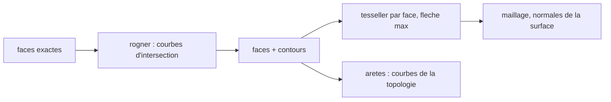

# Faces rognées

[booleen-carrure.md](booleen-carrure.md) calcule l’union et la différence sur des triangles. Le résultat est juste en volume et grossier à l’œil : la paroi se lit à facettes, et les cercles du fil de fer sont des polygones. Les trois modeleurs du banc d’essai prennent l’autre chemin. Le sprint qui le code est [sprint 14](../sprints/sprint-14-faces-rognees.md).

## Ce que font Fusion 360, FreeCAD et Creo

Le booléen porte sur le modèle exact. Fusion s’appuie sur Parasolid, FreeCAD sur OCCT, Creo sur Granite. Une union produit des faces bornées par des courbes d’intersection. Le cylindre reste un cylindre après l’ajout d’une corne : il est seulement rogné par une arête nouvelle.

Le maillage vient après, face par face, jusqu’à une flèche maximale exprimée en longueur. Un trou de 1,5 mm et un cercle de 40 mm n’ont donc pas le même pas. FreeCAD nomme ces réglages « Deviation » et « Angular deflection », Creo l’exactitude et la qualité d’affichage, Fusion la finesse d’affichage.

La normale d’un sommet est celle de la surface en ce point. Deux faces voisines ne partagent pas leurs sommets, donc l’arête entre elles est vive sans seuil d’angle. Le lissage par angle de cassure appartient aux moteurs de jeu.

Les arêtes tracées sont les courbes de la topologie, tessellées pour elles-mêmes, plus finement que les faces. C’est ce qui donne des cercles nets. Aucune n’est devinée dans le maillage.

## Ce que devient la frontière

Chaque face porte des contours dans son propre espace de paramètres. La face garde sa surface exacte ; le contour dit quelle part de cette surface est matière.

- Plan : deux axes dans le plan, contours en `u` et `v` millimètres.
- Cylindre : contours en angle et en longueur le long de l’axe.

Un contour est une suite de courbes : segment, arc, et courbe d’intersection paramétrée. Le sens du contour sépare le bord extérieur des trous.

## Les intersections de la carrure

Elles ont toutes une forme fermée. Aucune ne demande de marche numérique.

- Plan perpendiculaire à l’axe contre cylindre : un cercle. C’est la couronne d’une portée.
- Plan parallèle à l’axe contre cylindre : deux droites. C’est la joue d’une corne contre la paroi.
- Cylindre d’axe X contre cylindre d’axe Y : l’angle du petit cylindre paramètre la courbe. En un point d’angle `t`, la cote vaut `z = z0 + r sin t`, et la longueur `x = ±racine(R² − z²)`. C’est le trou de tige dans la paroi et dans le passage.

## Les faces coplanaires

Le dessus d’une corne et la couronne de l’anneau sont au même niveau. Elles deviennent une seule face, dont le contour est l’union en deux dimensions de la couronne et des quatre rectangles. Cette union de contours dans le plan est la pièce centrale du lot.

## La tessellation

Le pas suit la flèche, pas un nombre de segments. Pour un rayon `r` et une flèche `f`, l’angle d’un pan vaut `2 acos(1 − f / r)`. À 0,02 mm de flèche, un cercle de 20 mm prend environ 100 pans et un trou de 0,75 mm environ 20. La paroi redevient ronde, et le petit trou reste léger.

Les normales viennent de la surface : radiale sur un cylindre, constante sur un plan. Les sommets ne sont pas partagés entre deux faces, donc les arêtes restent vives.

## Tests

Un contour rogné donne une aire connue : la couronne du dessus moins l’empreinte des cornes. La joue d’une corne s’arrête sur la paroi, donc son contour a deux sommets au rayon extérieur. Le trou de tige rogne la paroi et le passage : la courbe existe sur les deux faces, avec la même cote en son sommet.

La flèche pilote le pas : à 0,2 mm la paroi a moins de pans qu’à 0,02 mm, et le rayon mesuré reste dans la flèche demandée. Les normales d’un cylindre sont radiales, celles d’un plan constantes.

Le fil de fer tient les cercles des couronnes à la tolérance des courbes, sans les cordes de la paroi.

## L’enveloppe borne la matière ajoutée

Une corne et un tube s’ajoutent par-dessus l’anneau. Les poches et les perçages se retirent après cette réunion : c’est l’ordre du modeleur, et il décide du rognage. La matière ajoutée s’arrête donc sur l’enveloppe extérieure de la pièce tournée, le cylindre plein sous la peau, et non sur l’anneau déjà creusé. Le passage, la portée de fond et la portée de lunette gardent ainsi leurs faces entières, et la peau perd la fenêtre que la corne occupe.

Les figures s’enfoncent jusqu’au passage : une corne part du rayon `racine(rayonInt² − demiLargeur²)`, un tube du rayon `racine(rayonInt² − rayonTube²)`. Leur face de départ tombe alors tout entière sous l’enveloppe, donc elle disparaît : le tube est soudé à la paroi, sans disque dans le vide.

Le jeu de classement vaut 0,05 mm, plus grand que la flèche. Les polygones de l’enveloppe et de la peau ont le même pas, donc leurs cordes se superposent ; un jeu plus grand que le creux d’une corde les fait se recouper franchement. Deux tests tiennent ces deux points : aucun sommet dans le passage au-dessus de la portée de fond, et aucune facette de départ au pied du tube.

Une paroi de trou est gardée dans chaque volume de matière qu’elle traverse, l’un après l’autre. Deux solides qui se recouvrent la garderaient deux fois. Sur la carrure, les barrettes restent dans les cornes et la tige passe de la paroi au tube, qui se touchent sans se recouvrir.

## Hors de ce lot

Les congés, les silhouettes des surfaces courbes, les arêtes tangentes en pointillé, les surfaces autres que plan et cylindre, l’intersection comme commande. L’arbre BSP de [csg.ts](../../packages/api-parametrique/src/csg.ts) reste pour mesurer un volume dans les tests.
