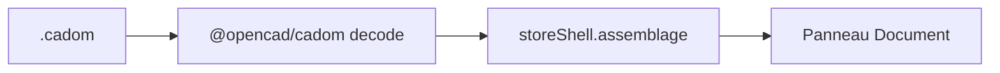

# Fichier `.cadom`

Plan de lecture du graphe d’assemblage. Sprint : [sprint-44-fichier-cadom.md](../sprints/sprint-44-fichier-cadom.md). SDK OpenCAD : [`@opencad/cadom`](https://github.com/naanouff/OpenCAD/tree/develop/packages/cadom) (O4-1…3). Doctrine : assemblage = `.cadom`, intention pièce = `.cadompart`.

## But

L’éditeur ouvre un `.cadom` protobuf, garde le graphe en mémoire (`CadomDocument`) et affiche l’arbre des nœuds dans le panneau Document. Pas de chargement mesh ni d’enregistrement `.cadom` dans ce palier.

## Détection

Octets `.cadompart` (version 0.2) restent le chemin pièce. Si `lire` refuse, tentative `decode` CADOM : `version_major = 0`, au moins un `root_id` et un nœud. Octets illisibles : erreur, session et assemblage inchangés.

## Hors périmètre (sprints suivants)

Late-load `.cadomesh` / glb (`planLateLoad`), écriture `.cadom`, pièces lunette/fond/verre/couronne, mates.
