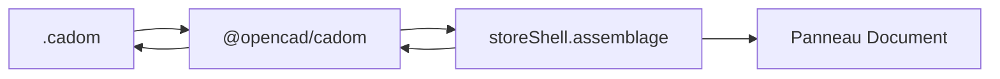

# Fichier `.cadom`

Plan de lecture / écriture du graphe d’assemblage. Sprints : [44](../sprints/sprint-44-fichier-cadom.md) (ouvrir), [45](../sprints/sprint-45-cadom-late-load.md) (plan late-load), [46](../sprints/sprint-46-enregistrer-cadom.md) (enregistrer). SDK OpenCAD : [`@opencad/cadom`](https://github.com/naanouff/OpenCAD/tree/develop/packages/cadom) (O4-1…3). Doctrine : assemblage = `.cadom`, intention pièce = `.cadompart`.

## But

L’éditeur ouvre et réécrit un `.cadom` protobuf (`decode` / `encode`), garde le graphe en mémoire (`CadomDocument`), affiche l’arbre et le plan late-load dans Document. Pas de fetch mesh dans ce palier.

## Détection

Octets `.cadompart` (version 0.2) restent le chemin pièce. Si `lire` refuse, tentative `decode` CADOM : `version_major = 0`, au moins un `root_id` et un nœud. Octets illisibles : erreur, session et assemblage inchangés.

## Enregistrement

Si `assemblage` est chargé → `encode(toLogical())` + nom `{root}.cadom`. Sinon → `.cadompart` (session pièce).

## Hors périmètre (sprints suivants)

Fetch URI / decode `.cadomesh` / glb, pièces lunette/fond/verre/couronne, mates.
