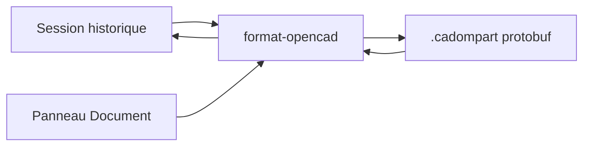

# Fichier `.cadompart`

Plan de lecture et d’écriture du fichier d’intention. Sprint : [sprint-32-fichier-cadompart.md](../sprints/sprint-32-fichier-cadompart.md). Le filet `pas` est préparé dans [pas-cadompart.md](pas-cadompart.md), sprint 33. Le document de session est dans [modele-document.md](modele-document.md). La doctrine des formats est celle d’OpenCAD, branche `develop`, spec [cadompart v0.2.2](https://github.com/naanouff/OpenCAD/blob/develop/documentation/specification/cadompart-v0.md) (2026-09-16).

## But

L’éditeur enregistre et rouvre l’historique d’une pièce dans un `.cadompart`. Le corps du fichier est un protobuf `cadompart.v0_2.CadompartFile`, `version_major = 0`, `version_minor = 2`. Le schéma source est `packages/cadompart-proto/cadompart.proto` du dépôt OpenCAD, commit `73473f6af72ce919b1f3bb9584b63d46ed436bfb`. La copie vit dans `packages/format-opencad/proto/cadompart.proto`.

Le fichier de travail est l’intention. Le maillage et le BREP se recalculent à l’ouverture.

## Paquet

`packages/format-opencad` dépend de `@opencad/api-parametrique` et du module protobuf généré (`pbjs -t static-module`). [api-parametrique](../../packages/api-parametrique) reste sans dépendance runtime. Le shell dépend du nouveau paquet.

L’écriture lit `session.historique()` et `session.document()`. La lecture produit des lignes de commande rejouées par `Session.executer`.

## Correspondance

| Historique | Fichier |
|------------|---------|
| Unité du document `mm` | Champ d’unité millimètres. Le défaut spec (mètre si non précisé) n’est pas laissé vide. |
| `param` | `Parameter` : expression d’origine et valeur évaluée |
| `esquisse` sur `dessus` / `12h` / `3h` | Datum du repère, puis feature `sketch` par `datum_plane_id` |
| `cercle`, `segment` | Courbes du sketch |
| `rectangle` | Quatre lignes et une boucle par rectangle. Une formule (`diametre_pozi / 4`) est relue |
| `revolution` | `revolve`. Les cotes du profil (`diametre_ame / 2`) sont relues |
| `pas` | Feature `helix`, `name` = `pas`. Le filet se recalcule |
| `cote` | `DIAMETER` ou `DISTANCE`. Une variable ou une formule est relue ; un nombre reste un nombre |
| `arc` | Courbe du sketch, avec son rayon s’il est coté |
| `concentrique` | Contrainte `CONCENTRIC`, la cible est relue (`cercle.exterieur`, `anneau`, …) |
| `symetrie` | Contrainte `SYMMETRIC` sur l’esquisse ouverte |
| `extrude` | `extrude`, `cut = false`, fin `BLIND`. L’expression (`hauteur_carrure`, une formule) est relue |
| `enlever` | `extrude`, `cut = true`. Même relecture de l’expression |
| `actif === false` | `suppressed = true` |

Les longueurs du fichier suivent l’unité déclarée. À la lecture, un fichier en mètres est converti en millimètres, et son champ `expression` est ignoré : le texte d’une variable est en millimètres. Les angles du fichier sont en radians.

## Ce que le fichier ne ramène pas

- L’auteur et la version semver du document. Ce sont des champs de session, pas de cadompart.
- La pointe d’arbre et le journal du terminal. À l’ouverture, la pointe est en fin d’historique.

Une feature hors du vocabulaire déjà reconstruit (fillet, hole, sweep, loft, booléen nommé, hélice dont le nom n’est pas `pas`, configuration), un id dupliqué ou un `body` vide rejettent le fichier. La session ouverte avant la lecture reste en place.

## Interface

Le panneau Document porte **Ouvrir** et **Enregistrer**. Le store remplace la session à l’ouverture et demande le maillage au worker. Chromium utilise le sélecteur de fichiers (`showOpenFilePicker` / `showSaveFilePicker`), filtre `.cadompart`. Les autres navigateurs utilisent un champ fichier et un téléchargement. Le sélecteur est injecté : les tests du shell ne l’ouvrent pas.

## État

Branché sur `feature/fichier-cadompart` : codec dans `packages/format-opencad`, boutons Ouvrir et Enregistrer du panneau Document. Le sélecteur de fichiers est injecté. Le script de carrure fait l’aller-retour : le maillage relu est le même, côté noyau provisoire et côté pipeline OCCT. Une esquisse rouverte sans nouvelle commande `esquisse` redevient une esquisse à la lecture. Une `symetrie` posée après la fonction, esquisse déjà consommée, n’est pas réécrite : elle ne changeait pas le solide.

## Hors de ce palier

`.cadom` (graphe d’assemblage qui référence des fichiers voisins), `.cadomesh`, `.cadombrep`, le ruban, Electron, l’assemblage de plusieurs pièces. STEP reste hors du modèle de vérité.
