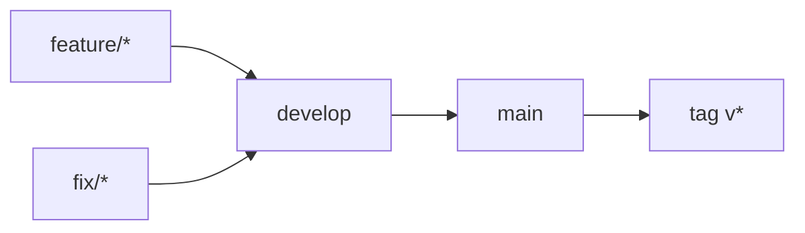

# Gitflow : protections et suppression post-merge

Sprint : [sprint-36-gitflow.md](../sprints/sprint-36-gitflow.md). Doctrine : [gitflow.md](../gitflow.md). Aligné sur [occt-wasm](https://github.com/naanouff/occt-wasm/blob/main/docs/gitflow.md).

## But

Finaliser le GitFlow déjà amorcé : `feature/*` | `fix/*` → `develop` → `main` → tag `v*`, avec protections actives et suppression automatique des branches de travail après merge.

## État au consignage (2026-10-11)

Sur [naanouff/OpenCadEditor](https://github.com/naanouff/OpenCadEditor) :

| Élément | État |
|---------|------|
| Branches `main` / `develop` | Présentes ; `develop` ahead de `main` |
| Rulesets `gitflow-protect-main` / `gitflow-protect-develop` | **Actifs** (PR obligatoire, pas de suppression ni force-push, bypass admin) |
| Sources [`.github/rulesets/`](../../.github/rulesets/) | Versionnées |
| `delete_branch_on_merge` | **true** (activé sprint 36) |
| Workflow `branch-policy.yml` | Versionné sur `feature/gitflow` |
| Branches `feature/*` déjà dans `develop` | Supprimées sur origin (liste ci-dessous) |



## Écarts à combler

1. **Suppression auto.** Activer `delete_branch_on_merge` via l’API GitHub (réglage dépôt, non versionnable dans les JSON rulesets).
2. **CI politique.** Workflow qui refuse `feature/*` / `fix/*` → `main` ; autorise `feature/*` / `fix/*` / `chore/*` → `develop` et `develop` → `main`.
3. **Doc.** [gitflow.md](../gitflow.md) décrit déjà le flux ; y consigner suppression auto et CI.
4. **Nettoyage.** Supprimer sur origin les branches déjà contenues dans `develop` (`ahead_by: 0`).

## Actions prévues

### 1. Activer la suppression auto

```bash
gh api repos/naanouff/OpenCadEditor -X PATCH -f delete_branch_on_merge=true
```

Effet : à chaque merge de PR, GitHub efface la branche source. `main` / `develop` restent protégées. Les trois méthodes de merge (`merge` / `squash` / `rebase`) sont conservées.

### 2. Workflow branch-policy

Créer [`.github/workflows/branch-policy.yml`](../../.github/workflows/branch-policy.yml) :

- Déclenché sur `pull_request` vers `main` et `develop`
- Échoue si base = `main` et head ≠ `develop`
- Autorise le reste du flux

Pas d’ajout de required status checks sur les rulesets (solo-dev : éviter de bloquer le merge si Actions est lent).

### 3. Nettoyage one-shot

Branches remote avec `ahead_by: 0` vs `develop` (candidates au consignage) :

`feature/pas-cadompart`, `feature/mcp-geometrie`, `feature/boulon-hexagonal`, `feature/datums-origine`, `feature/carrure-pipeline`, `feature/pointe-arbre`, `feature/gcs-esquisse`, `feature/pipeline-occt`, `feature/noyau-occt`, `feature/initial`, `chore/feuille-route-31`

Après activation de `delete_branch_on_merge`, les merges suivants font ce ménage seuls.

### 4. Vérification

- `delete_branch_on_merge` → `true`
- Rulesets toujours `enforcement: active`
- Workflow présent dans le dépôt

## Hors périmètre

- Branches `release/*` / `hotfix/*`
- Required approving reviews
- Promotion `develop` → `main` et tags dans ce sprint
- Required status checks liés à `branch-policy`

## État

Exécuté sur `feature/gitflow` (sprint [36](../sprints/sprint-36-gitflow.md)) : `delete_branch_on_merge` activé, workflow `branch-policy.yml` versionné, nettoyage des branches déjà dans `develop`.
