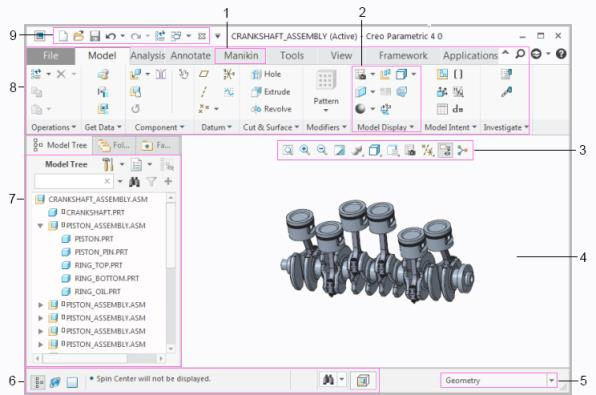
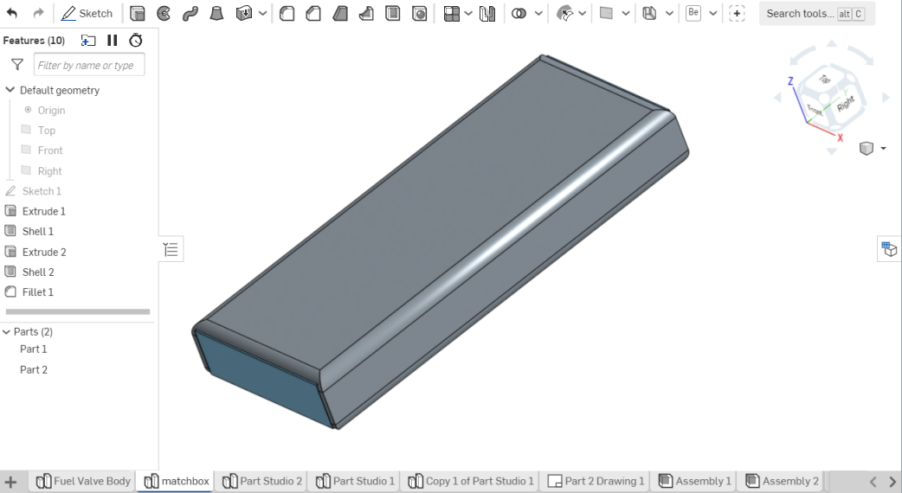
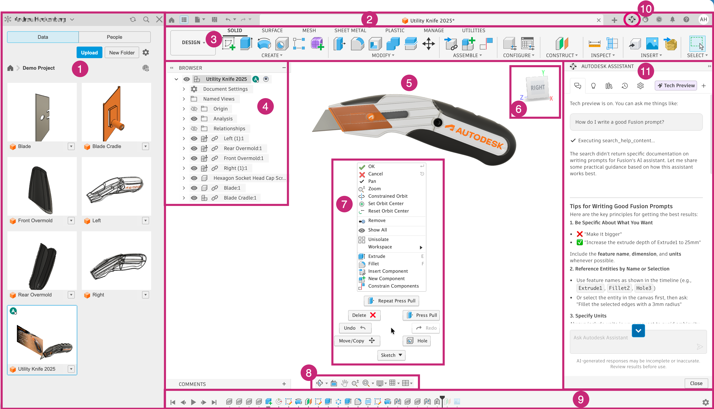
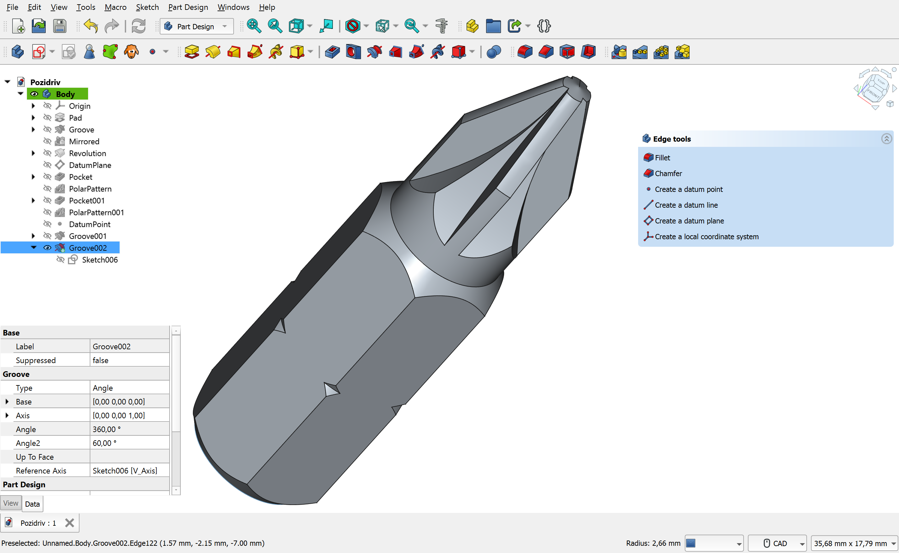
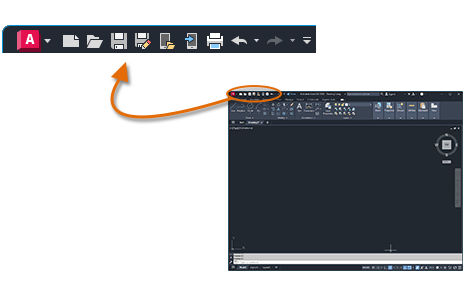

# Veille des interfaces

Observation des écrans du benchmark, avant toute reprise du layout. Le plan est [plan-interfaces.md](plan-interfaces.md). Les fichiers sont dans [interfaces/](interfaces/). Une image absente de ce dossier n’est pas décrite comme une capture.

Quatre repères : ruban ou barre d’outils, historique, viewport, réglage de la fonction en cours.

## Modeleurs 3D

### Creo

Source : [User Interface](https://support.ptc.com/help/creo/creo_pma/r13/usascii/tutorials_pma/user_interface.html), figure `pma_tutorials.1.006.4.jpg` (Creo Parametric 4.0, assemblage vilebrequin).

- Ruban : onglets en haut (File, Model, Analysis, Annotate). L’onglet Model groupe Hole, Extrude, Revolve, Pattern.
- Historique : Model Tree à gauche, hiérarchie de l’assemblage.
- Viewport : fenêtre graphique au centre, barre d’affichage au-dessus du modèle.
- Fonction en cours : pas de dialogue ouvert. La barre d’état et le filtre de sélection (Geometry) sont en bas.

Le schéma numérote aussi l’accès rapide et le filtre. Le cube de vues n’apparaît pas sur cette figure.

### Onshape

Source : [User Interface Basics](https://cad.onshape.com/help/Content/Home/user_interface_basics.htm), image `part-studioUI2-01.png`.

- Ruban : barre de fonctions en haut (Sketch et icônes de fonctions), champ Search tools à droite.
- Historique : liste Features à gauche (plans, Sketch, Extrude, Shell, Fillet) et barre de rollback. La liste Parts est en dessous.
- Viewport : modèle au centre, trièdre et cube de vues en haut à droite.
- Fonction en cours : aucune boîte ouverte. Les onglets de document sont en bas.

### Fusion 360

Source : [Fusion interface (desktop)](https://help.autodesk.com/cloudhelp/ENU/Fusion-GetStarted/files/GS-THE-FUSION-INTERFACE.htm), image `ui-overview-sept-26.png`.

- Ruban : onglets DESIGN, SOLID, SURFACE, puis groupes CREATE, MODIFY, ASSEMBLE.
- Historique : Browser à gauche (corps, esquisses, origine) et timeline en bas du canevas.
- Viewport : modèle au centre, cube de vues à droite du modèle.
- Fonction en cours : menu contextuel ouvert sur le canevas (Extrude, Fillet, Press Pull). Le panneau de données est à gauche, l’assistant à droite.

### FreeCAD

Source : dépôt de documentation [Screenshots](https://github.com/FreeCAD/FreeCAD-documentation/blob/main/wiki/Screenshots.md), fichier `PartDesign_Pozidriv.png`. Le wiki [wiki.freecad.org/Screenshots](https://wiki.freecad.org/Screenshots) renvoie un défi anti-robot ; le fichier vient du dépôt qui alimente ce wiki.

- Ruban : pas de ruban. Menus et barres d’outils, sélecteur d’atelier Part Design.
- Historique : arbre à gauche (Body, Origin, Pad, Groove, esquisses).
- Viewport : vue 3D, cube de navigation en haut à droite.
- Fonction en cours : éditeur de propriétés en bas à gauche (Groove, angle, esquisse). Un panneau de tâches Edge tools flotte à droite (Fillet, Chamfer).

### Inventor

Pas de fichier. La page [About the Autodesk Inventor View Interface](https://help.autodesk.com/cloudhelp/2026/ENU/Inventor-Help/files/GUID-E13A932A-6102-46E9-A132-05F205689777.htm) ne contient aucune image. [About the Ribbon](https://help.autodesk.com/cloudhelp/2027/ENU/Inventor-Help/files/GUID-78BFC5E2-5323-48E3-A704-58DDD1836EFE.htm) non plus. La page produit Autodesk répond 403.

Le texte de ces pages place le ruban en haut, le navigateur de modèle à gauche (fonctions dans l’ordre de création) et le modèle dans la fenêtre graphique. Un onglet contextuel vert s’ouvre dans l’esquisse. Aucune figure n’a été enregistrée.

### CATIA

Pas de fichier. L’image publiée sur [3ds.com/products/catia](https://www.3ds.com/products/catia) (`catia-1920x856.png`) est une campagne (route, pont, voilier), pas un établi. Elle n’est pas conservée.

La page communauté [CATIA Object Manager](https://3dswym.3dexperience.3ds.com/wiki/catia-user-community/catia-object-manager-2-com_syxTIEiJQhSSM4qRN0qLpA) décrit des établis, un arbre de spécification et une boussole 3D, sans figure téléchargeable.

### SOLIDWORKS

Pas de fichier. [User Interface Overview](https://help.solidworks.com/2024/english/SolidWorks/sldworks/c_user_interface_overview.htm) et les pages liées sont une coque qui ne livre pas les figures. Le PDF [INTRODUCING SOLIDWORKS](https://my.solidworks.com/solidworks/guide/SOLIDWORKS_Introduction_EN.pdf) refuse le téléchargement (accès refusé).

[Manager Pane](https://help.solidworks.com/2023/english/SolidWorks/sldworks/c_management_panel.htm) décrit, sans image exploitable : CommandManager pour les outils, FeatureManager à gauche (ordre de création, barre de rollback), PropertyManager à la place de l’arbre pendant une fonction, zone graphique à droite.

### NX

Pas de fichier. [Modeling](https://docs.sw.siemens.com/en-US/doc/209349590/PL20190701150722612.modeling/xid1757345?audience=external) cite le Part Navigator et n’embarque pas de figure d’interface. La une produit Siemens est une photographie d’atelier, pas un écran de modeleur ; elle n’est pas conservée.

### Solid Edge

Pas de fichier. [La page produit](https://www.siemens.com/global/en/products/solid-edge.html) montre une personne devant un écran ; le modèle est trop petit pour lire un ruban ou un arbre. La photo n’est pas conservée. Aucune figure de documentation n’a pu être extraite.

## Contraste 2D

### AutoCAD

Source : [Basics](https://help.autodesk.com/cloudhelp/2026/ENU/AutoCAD-GettingStarted/files/GUID-5B6347C1-B458-4336-AB2A-C16AF161B755.htm), image du ruban et de la fenêtre.

- Ruban : barre d’accès rapide (menu A, fichiers, annuler) et ruban à onglets au-dessus de la zone de dessin.
- Historique : pas d’arbre de fonctions de pièce sur cette figure.
- Viewport : zone de dessin sombre, réticule, disque de navigation.
- Fonction en cours : ligne de commande en bas de la fenêtre, pas un panneau de fonction 3D.

## Sans capture de ruban

OpenSCAD et CadQuery s’éditent dans un éditeur de texte. Aucune capture de ruban n’est collectée, comme prévu par le plan.

SolveSpace est hors de cette lecture d’écrans. Sa capture n’est pas dans le dossier.

## PLM, sans capture de modeleur

Windchill, 3DEXPERIENCE et Teamcenter restent hors de cette note d’écran : ce sont des outils de gestion, pas les modeleurs du benchmark.
