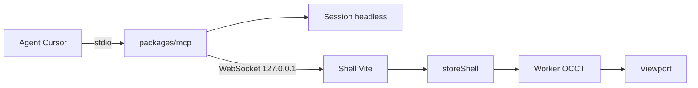

# MCP de géométrie procédurale

Sprint : [sprint-34-mcp-geometrie.md](../sprints/sprint-34-mcp-geometrie.md). Le langage est celui de [api-architecture.md](api-architecture.md) et de [commandes-milgauss.md](commandes-milgauss.md). Le maillage OCCT reste celui de [pipeline-occt.md](pipeline-occt.md).

## But

Un agent pilote la création par les lignes déjà lues par `Session` : `piece`, `param`, `esquisse`, `cercle`, `cote`, `extrude`, `enleve`, `revolution`, `pas`, `pointe`. Le même flux met à jour le viewport quand l’éditeur est ouvert.

`Session.lire` reste l’unique parseur. Un verbe nouveau est une ligne de plus, pas un outil de plus.

## Découpage

La session du processus MCP répond tout de suite : historique, paramètres, statut GCS. Le maillage OCCT est calculé dans le worker du navigateur ([`geometrieWorker.ts`](../../packages/shell/src/moteur/geometrieWorker.ts)). `etat.viewport` vaut `null` tant que le shell n’est pas connecté. Connecté, il porte le nombre de triangles et l’erreur éventuelle, jamais les sommets.

## Protocole

Le serveur écoute `127.0.0.1:47321`. Le port se change avec `OPENCAD_MCP_PORT`. Le shell s’y connecte au démarrage de `pnpm dev`.

Chaque mutation porte une origine. Le receveur l’applique une fois et ne la renvoie pas.

Au `bonjour`, le shell envoie les lignes réussies de son journal ([`panneauTerminal`](../../packages/shell/src/panneaux/terminal.ts)).

| Session MCP | Éditeur | Effet |
|-------------|---------|--------|
| vide | non vide | le MCP rejoue le script de l’éditeur |
| non vide | vide | le MCP envoie `remplacer` |
| les deux non vides et différents | | `etat.conflit` ; seul `aligner` (`mcp` ou `editeur`) écrase |

Le script synchronisé est le journal des lignes acceptées. On ne réimprime pas les `Operation` : `enleve travers` ne se reconstruit pas depuis les arguments.

## Outils

Descriptions en français, arguments en schéma zod. La réponse est un JSON court.

| Outil | Effet |
|-------|--------|
| `commande` | une ligne, comme le terminal |
| `executer` | un script, un seul `lot` |
| `etat` | pièce, unité, paramètres, historique, pointe, statut GCS, script, `viewport`, `conflit` |
| `annuler`, `refaire` | la pile de la session, et le journal du terminal |
| `pointe` | index de fonction, ou `fin` |
| `activer` | index d’historique et booléen |
| `aligner` | lève le conflit |

Une `ErreurApi` (`commande inconnue`, `esquisse non contrainte`) revient en erreur d’outil. La session ne change pas. Rien n’est envoyé au shell.

L’accusé du viewport attend la fin de `construction`, au plus 60 s. Passé ce délai, la commande est déjà appliquée et `viewport.erreur` le dit.

## Fichiers

Paquet `packages/mcp`, sur le modèle des autres : son `package.json`, dépendance `file:../api-parametrique`, `@modelcontextprotocol/sdk`, `zod`, `ws`, `tsx`.

- `src/index.ts` — `McpServer`, transport stdio, WebSocket.
- `src/outils.ts` — handlers sur une `Session` et le journal de lignes.
- `src/pont.ts` — clients, `bonjour`, file, délai.
- `tests/outils.test.ts`, `tests/pont.test.ts` — sans stdio réel.

Le shell ne dépend pas du SDK.

- `Session.reinitialiser()` vide pièces et piles. `remplacer` s’en sert, puis rejoue le script. Le worker garde le même objet.
- [`storeShell.ts`](../../packages/shell/src/storeShell.ts) — `refaire`, `remplacer`, drapeau anti-écho.
- [`protocole.ts`](../../packages/shell/src/moteur/protocole.ts) — messages `refaire` et `remplacer`.
- Journal du terminal — pile des lignes annulées, pour que `refaire` restaure la ligne.
- `packages/shell/src/pontMcp.ts`, branché depuis [`main.tsx`](../../packages/shell/src/main.tsx) en dev.

`.cursor/mcp.json` lance `pnpm --dir packages/mcp exec tsx src/index.ts`.

## État

Codé sur `feature/mcp-geometrie`. `Session.reinitialiser`, le paquet `packages/mcp` et le client dev du shell sont en place. Les tests couvrent les outils, le conflit au `bonjour` et l’anti-écho. Le nombre de triangles vu dans l’éditeur ouvert reste à confirmer à l’écran.

## Hors de ce palier

occt-wasm dans le processus MCP. Un outil par verbe. Une authentification autre que l’écoute locale.
