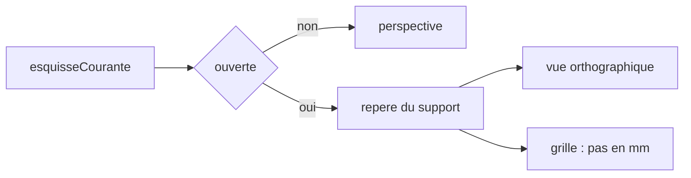

# Modes 3D et esquisse

La page ne connaît qu’une vue, en perspective. L’esquisse ouverte est déjà connue : `esquisseCourante()` pose ses cercles, et le viewport les trace. Il manque le changement de vue. Le sprint qui le code est [sprint 07](../sprints/sprint-07-modes-vue.md).

Le mode n’est pas une commande. Il suit l’esquisse.

- Pas d’esquisse : perspective, cadrage actuel. C’est le mode 3D.
- Esquisse ouverte : vue orthographique, face au plan du support, avec une grille dans ce plan et les cercles déjà tracés. `extrude` ou `enleve` ferment l’esquisse, et la vue revient en 3D.

Le solide reste dessiné. En mode esquisse il sert de repère. La caméra ne tourne plus autour de lui.

w3dts sait déjà les deux projections : `OrbitalCameraController.setProjectionMode`, `perspective` ou `orthographic`.

## Le plan

Le support est un nom : `plan.dessus`, `face.dessus`, `face.dessous`, `plan.12h`, `plan.3h`. Une fonction pure dans `packages/shell` le traduit en repère : origine, normale, deux axes. Y est la verticale. `plan.dessus` et `face.dessus` sont le plan horizontal. L’origine de la face du dessus est à la hauteur de la carrure, déjà portée par les cercles. `plan.12h` et `plan.3h` sont les deux plans verticaux du script.

## La grille

L’unité du document est le millimètre. Le pas est le multiple de cette unité qui reste lisible : 1, 5 ou 10 mm, choisi selon l’étendue visible. `pasGrille(etendueMm)` le choisit. Les traits sont des segments dans le plan, en mètres comme le reste du fil, ajoutés au même tableau que les cercles. Ils ne touchent pas au maillage. Le pas est fixé au moment où la vue se pose. Il ne se recalcule pas pendant un zoom.

Hors de ce lot : cotes dessinées, icônes de contraintes, saisie à la souris.
