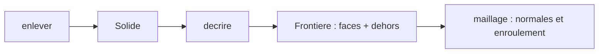

# Orientation des faces

La frontière décrite par [le noyau provisoire](../../packages/api-parametrique/src/noyau.ts) ne dit pas de quel côté est la matière. Le shell le devine, dans [documentCad.ts](../../packages/shell/src/documentCad.ts) :

```ts
const versExterieur = face.rayon === rayonMax ? 1 : -1
const ny = face.y > 0 ? 1 : -1
```

Un cylindre est tourné vers l’extérieur s’il a le plus grand rayon de la frontière. Une couronne regarde vers le haut si son altitude est positive. Ces deux règles suffisent pour un tube et une portée de lunette. Elles cèdent sur le tube de couronne, où deux cylindres intérieurs ont des rayons différents, sur un bossage extérieur, et sur une couronne posée à l’altitude zéro qui regarde vers le haut.

Seul le noyau sait où est le vide. C’est donc lui qui porte l’orientation. Le sprint qui le code est [sprint 06](../sprints/sprint-06-orientation-faces.md).

## Le champ

`FaceExacte` reçoit un champ commun `dehors`, le sens de la normale hors de la matière. Il vaut `1` ou `-1` :

- cylindre : `1` loin de l’axe, `-1` vers l’axe ;
- couronne : `1` vers le haut, `-1` vers le bas.

Le champ est obligatoire. Une face sans orientation ne se dessine pas, et le compilateur signale les oublis.

## Ce que pose le noyau

`decrire` remplit ce champ là où il construit déjà chaque face, sans nouveau calcul : paroi extérieure `1`, passage `-1`, dessous `-1`, dessus restant `1`, paroi de poche `-1`, fond de poche `1`.

## Ce que lit le shell

`maillage()` lit `face.dehors` pour la normale et pour l’ordre des sommets. `rayonMax` disparaît, ainsi que les deux tests sur l’altitude. Le canvas de `dessin.ts` reste en dehors : la page ne l’appelle plus.



Ce lot ne calcule pas la soustraction. Les faces de la portée restent une figure prévue d’avance. Il retire seulement au shell le soin de deviner leur sens.
