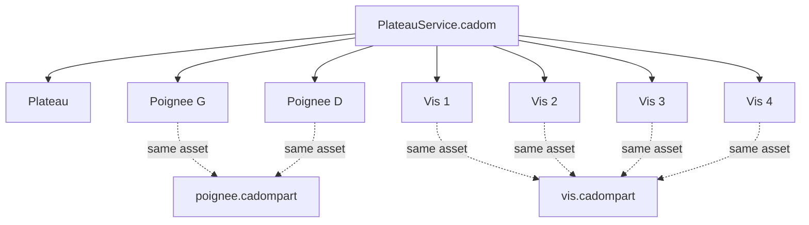

# Plateau de service — cas démo OpenCAD

Veille P6. Suit [assemblage-boite-cadom.md](assemblage-boite-cadom.md) et [affichage-topologique.md](affichage-topologique.md). Sprints prévus : 65 (pièces), 66 (assemblage + matériaux). Cap : [feuille-de-route.md](../suivi/feuille-de-route.md).

## Axe

Formats OpenCAD — illustrer parts, instances partagées, assemblage et matériaux d’affichage sur un cas plus simple que la Milgauss.

## But

Un plateau de service en aluminium, deux poignées en laiton vissées chacune par deux vis.

| Définition (asset) | Matériau | Instances |
|--------------------|----------|-----------|
| `plateau.cadompart` | aluminium | 1 × Plateau |
| `poignee.cadompart` | laiton | 2 × Poignée G / D |
| `vis.cadompart` | acier (neutre) | 4 × Vis (2 par poignée) |

## Géométrie (figée, sprint 65)

| Pièce | Cotes (mm) |
|-------|------------|
| Plateau | 280 × 180 × 8, centré, extrudé +Y |
| Poignée | barre 100 × 16 × 18, posée sur le plateau à x = ±100 |
| Vis | `SCRIPT_VIS` (Pozi 6 × 30). Dessous de tête à l’altitude locale 27 ; pointe à y = −1 pour que la tête affleure le dessus de poignée (y = 26). Entraxe 60 le long de X. |

Les esquisses sont centrées à l’origine : le plateau et la poignée ne sont pas percés. Les quatre vis marquent les perçages par leur pose.

Poses = transforms locaux fixes (pattern [`assemblageBoite.ts`](../../packages/shell/src/assemblageBoite.ts)). Pas de mates.

## Formats illustrés

| Format | Rôle |
|--------|------|
| `.cadompart` | Intention de chaque part |
| `.cadom` | Graphe 1+2+4 nœuds ; **même asset** pour les instances |
| `.cadomesh` | Badge Complete sans rebuild |
| `.cadomat` / `MATERIAL` | Alu / laiton — couleurs viewport |

## Écarts vs plumbing actuel

| Besoin | État |
|--------|------|
| Graphe multi-nœuds + transforms | OK (boîte) |
| Plusieurs nœuds → un asset | Format OK ; **jamais exercé** (boîte = 1↔1) |
| `.cadomat` | Spec + proto ; fixture `example-red-metal` |
| Teinte viewport | Gris PBR unique dans `viewportW3dts` — à brancher en 66 |

## Hors périmètre

Mates ; Exact `.cadombrep` ; zip / fetch HTTP ; physique matériaux ; éditeur `.cadomat`.

## Prérequis

P5 sprint 62 au minimum (solides lisibles). 63–64 peuvent avancer en parallèle des scripts de pièces.
