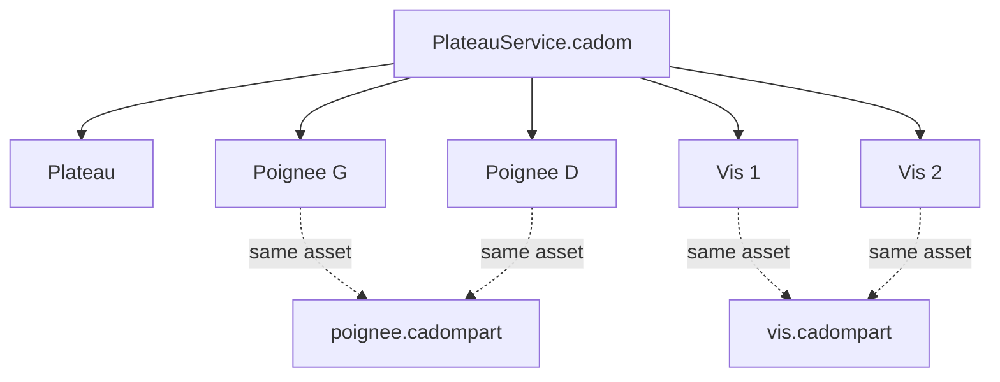

# Plateau de service — cas démo OpenCAD

Veille P6. Suit [assemblage-boite-cadom.md](assemblage-boite-cadom.md) et [affichage-topologique.md](affichage-topologique.md). Sprints prévus : 65 (pièces), 66 (assemblage + matériaux). Cap : [feuille-de-route.md](../suivi/feuille-de-route.md).

## Axe

Formats OpenCAD — illustrer parts, instances partagées, assemblage et matériaux d’affichage sur un cas plus simple que la Milgauss.

## But

Un plateau de service en aluminium, deux poignées en laiton, chacune tenue par deux vis M4 à tête noyée.

| Définition (asset) | Matériau | Instances |
|--------------------|----------|-----------|
| `plateau.cadompart` | aluminium | 1 × Plateau |
| `poignee.cadompart` | laiton | 2 × Poignée G / D |
| `vis.cadompart` | acier (neutre) | 4 × Vis (2 par poignée) |

## Géométrie (d’après le dessin)

Cotes dans [`cotesPlateau.ts`](../../packages/shell/src/cotesPlateau.ts).

| Pièce | Cotes (mm) |
|-------|------------|
| Plateau | 500 × 300, hauteur 15, centré. Poche de 470 × 270 creusée sur 10 : fond de 5, rebord de 15. Coins extérieurs R20 (`fillet … arete.vertical`), angles de poche R5 (`fillet … arete.poche`). Lèvre et fond de poche arrondis (R1,5 et R1), dessous chanfreiné à 1 (`chanfrein … arete.bas`). |
| Poignée | D à plat (vue de dessus du plan), esquissé sur `plan.12h` puis extrudé sur 12 (+Z). Deux bras de 14 partent des trous à entraxe 180 et finissent en demi-cercle autour d’eux ; la barre est à 40 de l’axe des trous, coudes R20 sur l’axe. Passage de la main : 25,5 entre le bord du plateau et la barre. À chaque trou : lamage Ø 8,4 × 2,5 puis passage Ø 4,5. Pourtour arrondi à R1 sur les deux faces (`fillet … arete.tranche`, qui ne prend plus le fond des lamages). |
| Vis | M4 × 20, tête fraisée Ø 8, pas 0,7. Le dessus de tête est 0,5 sous le dessus de la poignée (y = 26,5) ; la pointe s’arrête dans le rebord (y = 6,5). |

z = 0 local est le dessus de la poignée. La pose est une rotation propre (sans miroir) : +Y local, la saillie du D, sort du plateau ; +Z local, l’épaisseur, descend vers le rebord ; X local suit le petit côté. Le dessous repose sur le rebord (y = 15). Les trous sont au milieu du rebord (x = ±242,5, z = ±90). Chaque vis prend le centre de son trou, calculé par la même matrice que la poignée.

Le plateau n’est pas percé : le fût des vis entre dans le rebord plein.

Poses = transforms locaux fixes (pattern [`assemblageBoite.ts`](../../packages/shell/src/assemblageBoite.ts)). Pas de mates.

### Profil à arcs

Dans une esquisse `plan.12h`, les sommets `segment` et `arc` sont lus dans l’ordre, en (`rayon`, `hauteur`). Un `arc` est le point de passage d’un arc vrai entre ses deux voisins, qui doivent être des `segment`. Extrudé, le profil donne un prisme le long de +Z.

## Formats illustrés

| Format | Rôle |
|--------|------|
| `.cadompart` | Intention de chaque part |
| `.cadom` | Graphe 1+2+4 nœuds ; **même asset** pour les instances |
| `.cadomesh` | Badge Complete sans rebuild |
| `.cadomat` / `MATERIAL` | Alu / laiton — couleurs viewport |

## Écarts vs plumbing actuel

| Besoin | État |
|--------|------|
| Graphe multi-nœuds + transforms | OK (boîte) |
| Plusieurs nœuds → un asset | Format OK ; **jamais exercé** (boîte = 1↔1) |
| `.cadomat` | Spec + proto ; pas de codec runtime : table URI → teinte (`MATERIAUX_ASSEMBLAGE`) |
| Teinte viewport | OK : matériau par face jusqu’au viewport (alu, laiton, acier) |

## Hors périmètre

Mates ; Exact `.cadombrep` ; zip / fetch HTTP ; physique matériaux ; éditeur `.cadomat`.

## Prérequis

P5 sprint 62 au minimum (solides lisibles). 63–64 peuvent avancer en parallèle des scripts de pièces.
