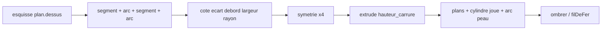

# Profil des cornes

Les cornes de [cornes-barrette-tube.md](cornes-barrette-tube.md) sont quatre boîtes issues d’un rectangle. Les croquis demandent une joue courbe à la place des angles droits. La voie retenue est un **profil d’esquisse fermé** : segments et arcs cotés, puis `extrude`, dans le flux de [flux-construction-parametrique.md](flux-construction-parametrique.md). Le sprint qui le code est [sprint 16](../sprints/sprint-16-profil-cornes.md).

## Contour d’une corne

Vue de dessus (plan XZ), une corne est un contour fermé de quatre courbes :

1. **Segment intérieur** — parallèle à X, à `entrecorne / 2`.
2. **Segment de bout** — parallèle à X, à `rayonExt + longueur_corne`. Sa largeur vaut `largeur_corne`.
3. **Arc de joue** — cercle d’axe Y, rayon `rayon_joue`, qui relie le coin extérieur du bout au point d’appui sur la peau. Pour la paire 12 h, le centre est sur l’axe 12 h–6 h (`x = 0`), choisi pour que l’arc passe par ces deux points.
4. **Arc d’appui** — tronçon du cercle extérieur de la boîte (`diametre_boite / 2`) entre les deux points d’entrée dans la paroi.

`largeur_corne` fixe la largeur au **bout**. La joue courbe consomme la matière du rectangle actuel vers l’extérieur : les angles droits disparaissent.

Nouveau paramètre : `rayon_joue`. Valeur pédagogique initiale : `28` mm (un peu plus grande que le demi-écart des bouts à 25 mm de rayon).



## Script

Le bloc rectangle du script de carrure devient :

```
param rayon_joue 28
esquisse plan.dessus
segment
cote ecart entrecorne
arc
cote rayon rayon_joue
segment
cote debord longueur_corne
cote largeur largeur_corne
arc
concentrique cercle.exterieur
symetrie vertical
symetrie horizontal
extrude hauteur_carrure
```

Un seul profil fermé avant les deux symétries. La barrette et le tube gardent leurs lignes actuelles.

## Données

`EntiteEsquisse` gagne `segment` et `arc`. `cote` retient `rayon` sur un arc, en plus des cibles déjà connues. Un profil fermé est la boucle cotée courante : le solveur en compte les degrés.

À l’`extrude`, le profil évalué devient un `Ajout` `{ sorte: 'profil', … }`. L’ajout `rectangle` reste accepté tant que d’anciens tests le demandent.

## Faces exactes

Pour chaque corne, `decrire` émet :

- les plans du dessus, du dessous, du bout et du côté entrecorne ;
- un `cylindre` d’axe Y pour la joue, rayon `rayon_joue`, bornes angulaires `angleDeb` / `angleFin` (tronçon, pas un tour complet) ;
- l’arc d’appui comme tronçon déjà porté par la peau : l’enveloppe et `ombrer` bornent la matière ajoutée comme pour les boîtes.

Les barrettes restent quatre traversées. Le tube et la tige restent inchangés.

## Affichage

`tesseler` maille un cylindre tronçonné. `filDeFer` trace les deux segments et les deux arcs, sans les douze arêtes d’une boîte. `ombrer` classe la joue comme les autres faces tournées et la borne par l’enveloppe.

## Tests

Après l’extrusion des cornes, la frontière porte un cylindre de joue de rayon `rayon_joue`, et plus de `boite` rectangle pour ces figures. La silhouette n’a plus de sommet au coin extérieur de l’ancien rectangle dans la zone coupée par l’arc. `param rayon_joue` change la cambrure. `entrecorne` et `diametre_boite` reconstruisent. Les quatre barrettes restent ouvertes ; le tube, sa fermeture et le perçage de tige restent.

Un test du shell vérifie que `filDeFer` porte des arcs de joue.

## Hors de ce lot

Les congés 3D, le chanfrein de lunette, les cotes du profil affichées dans le viewport, les contours BRep encore ouverts du sprint 14, une extrusion de profil arbitraire au-delà des cornes. Les congés de bout en élévation sont dans [profil-elevation-cornes.md](profil-elevation-cornes.md).
