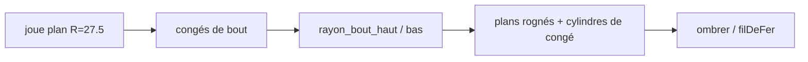

# Profil d’élévation des cornes

La joue en plan ([profil-cornes.md](profil-cornes.md)) est en place avec `rayon_joue` 27,5 mm. Vue de dessus, les angles droits du rectangle ont disparu. Vue de **côté** (élévation le long de 12 h–6 h), chaque corne reste un rectangle de hauteur `hauteur_carrure` : le bout est encore à angles droits. Les croquis demandent un **profil d’élévation** : congés au bout, haut plus ouvert que bas. Le sprint qui le code est [sprint 17](../sprints/sprint-17-profil-elevation-cornes.md).

## Silhouette

Vue le long de l’axe 3 h–9 h (plan YZ pour la paire 12 h–6 h), la bande de matière d’une paire de cornes forme un rectangle allongé, percée d’un trou de barrette près de chaque bout. Le contour voulu au **bout** :

1. **Congé haut** — grand rayon : part du dessus, descend vers la face de bout, à mi-hauteur environ.
2. **Congé bas** — petit rayon : arrondit le coin inférieur du bout.
3. **Milieu** — le dessus et le dessous restent plats entre les deux bouts ; la jonction corne–peau n’est pas retouchée dans ce lot.

Même geste aux quatre bouts (12 h et 6 h, deux cornes chacune).

## Paramètres

| Paramètre | Rôle | Valeur pédagogique |
|-----------|------|--------------------|
| `rayon_joue` | Cambrure en plan (déjà là) | `27.5` |
| `rayon_bout_haut` | Congé supérieur du bout | `2.5` |
| `rayon_bout_bas` | Congé inférieur du bout | `0.8` |

Les deux rayons de bout restent sous la demi-hauteur (`hauteur_carrure / 2`) pour ne pas se croiser sur la face de bout. La barrette (axe à mi-hauteur) reste ouverte.

## Données

Pas de nouvelle esquisse dans ce lot : les cotes viennent des paramètres, comme la position pédagogique de la barrette. `Ajout.profil` gagne `rayonBoutHaut` et `rayonBoutBas` (lus depuis les paramètres à l’`extrude`, ou fixés après coup sur le solide). L’esquisse plan.dessus et `segment` / `arc` ne changent pas.

## Faces exactes

Pour chaque corne, en plus de la boîte et du cylindre de joue :

- un `cylindre` d’axe parallèle à la largeur du bout (axe X pour 12 h / 6 h), rayon `rayon_bout_haut`, tronçon de congé au coin supérieur ;
- un `cylindre` analogue pour `rayon_bout_bas` au coin inférieur.

`ombrer` retire la matière hors de ces quarts de cylindre (coin du rectangle coupé). `filDeFer` trace les arcs de congé. Les quatre barrettes, le tube et le perçage de tige restent.

## Tests

Après reconstruction, aucun sommet de corne ne reste au coin supérieur ni inférieur de l’ancien bout rectangle. `param rayon_bout_haut` et `param rayon_bout_bas` changent la cambrure d’élévation. `rayon_joue` 27,5 reste. Les barrettes restent ouvertes.

## Hors de ce lot

Congés à la racine (jonction peau), chanfrein de lunette, cotes du profil à l’écran, esquisse d’élévation cotée en place des paramètres, extrusion de profil arbitraire.
