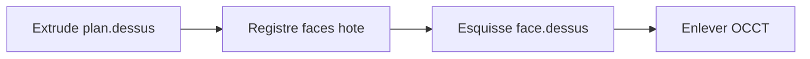

# Références topologiques — faces v1

Plan d’exécution de l’item 5 de [direction-modeleur.md](direction-modeleur.md). Sprint : [sprint-28-topo-faces.md](../sprints/sprint-28-topo-faces.md). Précède [gcs-enrichi.md](gcs-enrichi.md) et [carrure-pipeline.md](carrure-pipeline.md).

## But

Après une extrusion générique, `face.dessus` et `face.dessous` sont des **supports d’esquisse stables au rebuild**, utilisables pour une poche OCCT. Ce n’est plus le `Set` provisoire de `noyauProvisoire` seul.

## Modèle

| Élément | Décision |
|---------|----------|
| Stockage | Registre hôte rempli au compile OCCT : `{ id, origin, normal }` |
| Noms v1 | `face.dessus` = face planaire max Y ; `face.dessous` = min Y (extrude +Y) |
| Persistance | Pas encore d’IDs BREP dans `.cadompart` |
| Validation | `ouvrir face.*` OK si le registre (ou `aFace` provisoire) connaît le support |
| Coupe | `enlever` suit normal/origine du support, pas un `yMax` global |

## Critères

1. Boîte → extrude → `esquisse face.dessus` + cercle + `enleve` → poche dans le maillage OCCT.
2. Changer la hauteur d’extrusion : le support reste valide au rebuild.
3. `esquissePolylines` place le wire sur le plan de la face.

## État

Branché et validé à l’écran sur `feature/topo-faces` (sprint 28) : registre hôte, polylines `face.*`, coupe OCCT orientée.

## Hors périmètre

Arêtes nommées, verbe `nommer`, faces après booléens complexes, carrure complète.

## Point de vigilance

Les cercles partent en **polyline densifiée** (~48 segments) vers OCCT (`esquissePolylines`). Le trou n’est donc pas un cylindre B-Rep : le fil de fer montre une génératrice par facette. Attendu en v1. Suite : arcs / cercles natifs côté kernel pour un fil de fer « Creo » (cercles + peu de génératrices).
